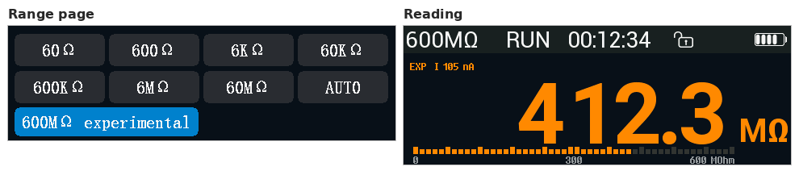
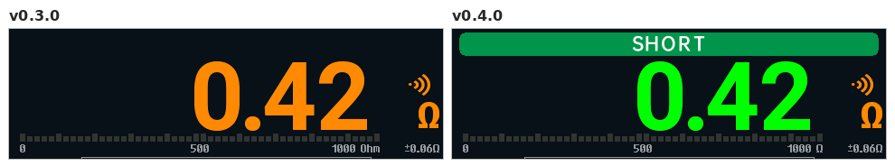

# Changelog

User-facing changes of opendm40 per release. The release workflow
([.github/workflows/release.yml](.github/workflows/release.yml)) uses the
section named after the tag as the release notes; how to cut a release:
[firmware/README.md, Releasing](firmware/README.md#releasing).

## Unreleased

### New

- **SD in the MIN/MAX/AVG column:** the standard deviation of the readings
  since the statistics started; SCPI `CALCulate:AVERage:SDEViation?`.
- **Mode Remember** (Settings > More > More, as the stock's; default OFF):
  ON restarts the multimeter after a power-off in the function, range, rate
  and trend timebase you left. SCPI `MEMory:STATe:RECall:AUTO`.
- **Trend chart:** two slower timebases, 1.28 and 2.56 s/div.
- **Russian README and user manual:** [README.ru.md](README.ru.md) and
  [docs/manual/README.ru.md](docs/manual/README.ru.md), with a language
  switch at the top of each.
- **600 MΩ range, experimental:** on the range page or SCPI
  `RES:RANG 600E6` only, never in AUTO; accuracy not specified. Leave the
  leads open once: it learns the meter's own leakage
  ([manual](docs/manual/README.md#resistance)).

  
- **Continuity and diode: a green SHORT band** above the reading and green
  digits while the beeper sounds, also at volume 0 %; **BEEP** for a diode
  pattern ([manual](docs/manual/README.md#continuity)).

  
- **Scope: the generator as a trigger source** (MF > Trigger > Source GEN):
  the trigger is computed from the generator's timers, no wire needed;
  and a **GEN trace** (MF > Display) showing the generator's output under
  CH1 ([manual](docs/manual/README.md#trigger)). SCPI `TRIGger:SOURce`.
- **Scope: the multimeter as CH2** (MF > Display > CH2 (DMM)): the
  multimeter's input drawn over CH1 on the same time axis, in V, mV and
  AC A ([manual](docs/manual/README.md#display-settings)). The multimeter
  reading pauses while it is on.

### Changed

- **Test builds of pull requests:** each pull request gets a comment with
  its update file to try (version `0.4.0-pr<N>.<commit>`)
  ([manual](docs/manual/README.md#install)).
- **Record button on the range pages:** MF, then **Record** opens the Record
  page (red while recording); **Hold/Limits** is now **Limits**
  ([manual](docs/manual/README.md#the-record-page)).

  
- **The update loader no longer opens by itself** after repeated hangs (a
  hang restarts the meter).
- **Leaving the update loader:** opened with the power-key hold or
  `DBG:LOADER`, the loader now lets the installed firmware start again when
  you switch the meter off and on; no reinstall is needed.
  [How to reach it](docs/manual/README.md#reach-the-update-loader).
- Smoother screen changes: pages, popups and DMM functions draw over the old
  screen, not over a blank one; an MF menu tab redraws only the menu.
- The menu, settings, range, help, generator and oscilloscope pages appear
  top to bottom in one pass, with no half-drawn widgets.
- **Continuity says OPEN** next to the big `0L` with open leads (Overflow
  when the reading climbed there, e.g. a charging capacitor); diode and the
  other functions say "Overflow" where "Overload" was
  ([manual](docs/manual/README.md#overflow)).
- `DBG:TOUCH?`, `DBG:PROF?` and `DBG:ACDC:TRACE` (debug) are only in
  builds with the `dbg-touch` / `dbg-prof` / `acdc-trace` features
  ([SCPI reference](docs/manual/scpi-reference.md#debug-commands)).
- **Auto power-off on battery only:** with USB power (a computer or a
  charger) the meter never switches itself off; after the unplug the
  **Shutdown** time counts afresh
  ([manual](docs/manual/README.md#power-battery-and-sleep)).

### Fixed

- Capacitance AUTO: a small capacitor measured after a large one (600 µF and
  up) gets its own range again instead of a wrong µF value; open leads or a
  short after a large capacitor no longer leave **0L mF** / **0.0 mF** on the
  screen.
- Capacitance: 6 mF and up read in µF (4700 µF, not 4.700 mF).
- Capacitance ranges on the meter: MF chooses 60 nF .. 60000 µF or AUTO; the
  AUTO key steps and resets them as in V / A / Ω. The 6 nF and 60 nF ranges
  are one (below 6 nF with 3 decimals).
- Capacitance: 1 .. 47 mF show their first value in about 1.5 to 5 s (was
  9 to 20 s; 47 mF did not settle); AUTO starts on the last value's range;
  the value stays grey until the slope settles (electrolytics); another
  capacitor on 6 / 60 mF starts the range choice again.
- Capacitance on 600 µF and up: a value every 0.25 s (the median of the
  last polls, corrected for the ramp's two directions), grey until the ramp
  has run both ways; "Discharging" with a rough grey value while the meter
  discharges, orange "Charged cap: discharge first" above ~1.2 V; a charged
  capacitor (up to 5 V) discharges about twice as fast.
- Capacitance: the bargraph spans the range (600 nF on the 600 nF range), not
  ten times it.
- Power meter: **Vb 0.000** no longer in the warning colour with open leads.
- Power meter AC+DC: with no current PF reads "--" (SCPI `+9.91E37`), not 0.
- Generator: the square wave's preview follows the duty cycle; it always showed 50 %
  ([#81](https://github.com/opendm40/opendm40/issues/81)).
- Scope Save CSV after a timebase change while stopped: the file header names the timebase the record was
  taken at, not the one shown.
- Scope: a setting changed over SCPI while a popup is open shows at once in the top bar, the right
  panel and the trace beside the popup, not only after it closes ([#82](https://github.com/opendm40/opendm40/issues/82)).
- **Battery charging** is shown: on the charger the battery is green, its top bar blinks while it charges
  and stays when full; a USB symbol (also on the scope page) while a computer has the meter connected
  ([manual](docs/manual/README.md#the-status-bar)).
- Scope page and combined view: the top bar shows the **Bluetooth symbol** while a phone or a computer is
  connected over Bluetooth, beside the USB symbol when both are connected ([#167](https://github.com/opendm40/opendm40/issues/167)).
- **Bluetooth SCPI:** a host that disconnects during a query no longer leaves
  that reply for the next host to connect.
- **Bluetooth SCPI:** pipelined block queries (`WAV:DATA?`, `LOG:DATA?`) no
  longer lose the last reply; input lost to a full receive buffer is reported
  (-363) instead of running cut commands.
- **USB SCPI:** long replies such as `MMEM:DATA?` go out at full USB speed
  while the scope page draws (with CH2 on they were several times slower).
- **SCPI:** `SCOPe:MEASure:...?` without a value answers `+9.91E37` (no
  value), not `+0.000000E-03`.
- **SCPI:** a number outside a setting's range queues `-222 Data out of range`, as documented
  (`SYST:BEEP:VOL`, `SYST:ALER:ENAB`, `LOG:OSR`, `LOG:DUR`, `LOG:SRAT`, `LOG:CSV:INT` / `DUR`);
  `LOG:SOUR` takes `ad1` / `ad2` in any case; `MMEM:DATA?` without a name queues `-109`.
- SCPI: `ACQ:SRAT?` of a stopped scope after a zoom answers the stored record's sample rate, as
  the record preamble (`WAV:POIN MAX`) and Save CSV use, not the shown timebase's ([#158](https://github.com/opendm40/opendm40/issues/158)).
- SCPI: `INRush:THReshold` and `POWer:PHASe` with a number out of range queue
  `-222 Data out of range`, not `-224 Illegal parameter value`.
- `DBG:PING?`: the keepalive field reads `4294967295` (no limit) after boot
  instead of a wrapped number ([#97](https://github.com/opendm40/opendm40/issues/97)).
- **Limits:** a huge limit set over SCPI (`CALC:LIM:UPP 1E20`) no longer restarts
  the meter when the Hold/Limits page opens.
- Multimeter: a value that rounds to zero shows no minus sign (open DC V
  leads showed "-0.0000").
- **SCPI:** `TRIGger:LEVel` keeps the level as given; it was up to one screen
  row lower (0.1 V became 0.113 V at 500 mV/div).
- SCPI: `WAVeform:DATA?` in BYTE format is no longer 1.5 codes low on
  average (the preamble's `yorig` is the middle of a byte's four codes).
- Scope: the V/div label is right with x2, x5 and the other non-decade
  probes (x5 at 2.5 V/div showed 2V).
- Recording: a red dot blinking every second and **REC** in the status bar;
  on the scope page and the combined view a red dot and **DMM** in the top
  bar, in place of MCX | DMM
  ([#101](https://github.com/opendm40/opendm40/issues/101)).
- **Gallery:** the recording in progress reads **Recording** instead of **No data**, and its
  **Delete** says **Stop the recording** instead of **Disk busy, try again**.
- A function change over USB / Bluetooth closes the power meter's wiring
  and "Reset energy?" dialogs and the fuse check dialog (they stayed over a
  page no longer updated).
- Hold & Limits: MENU and Back return to the range page (Power Settings)
  it was opened from, not to the multimeter page.
- Temperature page: the cold junction line follows the readings and the
  offset while the page is open.
- Inrush: the Trigger - / + no longer step the wrong way from a threshold
  set over SCPI below 0.2 A or above 10 A.
- Bargraph scale: the unit spelled as the reading beside it (600 KΩ, not
  600 kOhm).
- **Scope, stopped:** a zoom, or a Single capture that ended, right after a
  screenshot kept the old trace on the screen.
- Scope: Duty, Wid, Vtop, Vbas and Vamp are right on triangle and ramp
  signals (they jumped, e.g. 65 % duty on a triangle).
- Scope roll mode: the measurements show -- instead of the values from
  before roll started; `WAV:DATA?` follows the rolling trace.
- Scope: text stays readable in every channel colour (dark on a yellow, gold
  or pink math panel; white on a blue or purple CH1; a lighter blue, purple or
  brown for the trigger level, measurements and FFT labels).
- DMM trend chart: a range change to another unit that reads OL (6 V to
  600 mV on 3.3 V) starts the chart over in the new unit.
- Power meter: no multimeter MAX / AVG / REL / MIN column while the page
  shows "I ranging...".
- **Key/alert volume 0 %** also silences the continuity and diode beeper
  ([manual](docs/manual/README.md#settings-page-1)).
- Combined view: the meter strip shows **POWER**, the range and dashes while
  the power meter ranges, not an empty strip.
- **Inrush:** the automatic power-off no longer switches the meter off while
  the page is armed and waits for a load to start
  ([#144](https://github.com/opendm40/opendm40/issues/144)).
- Settings: **Backlight** - / + keep to the 10, 15, 25 ... 95, 100 % steps
  after an end (10 + gave 20 %, and 55 % was out of reach)
  ([#91](https://github.com/opendm40/opendm40/issues/91)).

## v0.3.0 (2026-10-27)

### New

- **Accuracy of the reading** under the unit, from the DM40 manual for your
  model; digits finer than it are grey. Settings > More > More > Accuracy
  ([manual](docs/manual/README.md#accuracy)).

  

- **60 Ω range** with milliohm digits, on the range page and in AUTO
  ([manual](docs/manual/README.md#resistance)).

  

- **Negative ohm** (Settings > More > More): shorted leads read below zero
  instead of 0.000. SCPI `RESistance:NEGative`.

  

- **Scope:** the timebase list shows each entry's sample rate
  ([manual](docs/manual/README.md#timebase)).

  

- **Start-up:** a splash with the version and a progress bar; the meter page
  comes up in about 0.7 s instead of 4 s.

  

### Fixed

- **Scope did not turn on** (a flat trace at the bottom) after power-on with
  Analog power set to Both always or a start page other than Multimeter: the
  analog supply was switched wrongly. Switching to Auto or opening the scope
  then could turn the meter off.
- **Frequency:** 2 Hz and 5 Hz gave no reading; it now reads down to 0.5 Hz,
  with one more (small) digit where the counter allows it
  ([manual](docs/manual/README.md#frequency-and-duty-cycle)).

  

- **Generator:** after OFF and ON the sine, triangle and ramp stayed flat
  until a restart.
- **Continuity / diode:** touching the probes together no longer shows
  A-JACK.
- **Scope:** closing a popup is about 4x faster; the tap's beep is short
  again.
- **AC V:** the first readings after a range step on a signal with a DC part
  read high; they are grey until settled.
- A calibration record with a bad CRC is ignored, as the stock firmware does.
- Holding AUTO shows AUTO at once, not the last manual reading.
- The rate chip and the message after a tap on the reading show the new rate
  at once.

### Changed

- No logo in the status and title bars.

## v0.2.0 (2026-10-25)

### New

- Touch calibration: **Calibrate** on the touch test page (Settings > More
  > More > Touch test) fits a correction to taps on its nine targets,
  shows the remaining error and applies it on Save; kept in the settings.
  Without one the touch points are used unchanged, as the stock does
  ([manual](docs/manual/README.md#touch-calibration); `DBG:TOUCH:CAL`).
- Multimeter: a 60 mV range (on the range page, and first in the mV AUTO).
- Ohm and diode: the test current is shown next to the reading, from
  currents measured on the meter (e.g. 0.756 mA for the diode test).
- "Overload" is shown next to `0L`.
- Scope touch: the trigger-level marker sits on the graph's right edge and
  moves the trigger point; a press near a marker grabs the nearest one; a
  drag stays on one item and one axis; pinch modes with one step per 1.25x.
- Power meter: the wiring dialog draws the meter's jacks (VΩ / COM / A) and
  the current path through the meter.
- SCPI: IEEE 488.2 suffix multipliers, an error queue with codes
  (`SYSTem:ERRor?`), no reply to a query in a message with a bad set value;
  `LOG:FORMat ROWS|PACKed|DLG` for compact `LOG:DATA?` replies
  ([SCPI reference](docs/manual/scpi-reference.md)).
- The settings are kept in `_SETTING.BIN` on the internal disk.
- The version comes from one place, `firmware/Cargo.toml`: `*IDN?`,
  Settings > Device, the USB disk texts, the CSV headers and the install
  file `dm40_opendm40_v<version>.bin` show the same string.
- Settings > More > More > Touch test: a page that shows every touch the
  controller reports, the points after the debounce and the touch keys,
  against crosshair targets, to check the touch calibration
  ([manual](docs/manual/README.md#touch-test)).

### Changed

- USB ID `1209:D040` (opendm40's own PID under the pid.codes VID) instead
  of the pid.codes test ID `1209:0001`; udev rules and VISA resource
  strings change accordingly. The host tools accept both.
- Multimeter rate (DC V, mV, A and Ω): every rate now rejects 50 Hz and
  60 Hz hum. FAST: 10 readings/s (Ω 5/s); in DC V / mV / A the converter
  runs without its chopper and the meter measures its offset itself (2 s
  after a change, then every 30 s; two readings skipped each time). MED: 5
  readings/s (Ω 2.5/s as before), the extra digit after 1.6 s. SLOW: 2.5
  readings/s. Before,
  FAST and MED ran a 50 ms conversion that did not reject 50 Hz
  ([manual](docs/manual/README.md#rate-fast-med-slow)).

- Resistance: the 60 Ω range is removed (the range page, the AUTO key cycle;
  `RES:RANG 60` and `RES:RANG MIN` select 600 Ω). It read about 2.7 % low
  against the 600 Ω range for a reason not known, and its entry in the
  calibration record is not a calibration. The lowest range is 600 Ω, as on
  the stock firmware.
- Multimeter AUTO key (voltage, current, resistance): a short press fixes
  the present range, then steps to the next higher range, wrapping from the
  highest to the lowest; held 1 s it returns to the default autorange
  (AUTO+ on volts). It still clears HOLD and REL; AutoHold stays on.
- Multimeter: with a fixed range the status bar shows the range (e.g.
  **6V**, **600mV**, **6000uA**, **6KΩ**) instead of **MANU**, as the stock
  firmware does; the meter strip's badge too.
- A power-off starts a new measurement: DC V, and the measurement settings
  (ranges, AutoHold, limits, rate, the scope's acquisition and trigger, the
  power meter, the Record page) at their defaults; the preferences are kept.
  A reset or a firmware update continues the measurement.
- The version is shown with three parts (`0.1.0`, `dm40_opendm40_v0.1.0.bin`,
  tag `v0.1.0`).
- The firmware is named opendm40 everywhere (device strings, image name).
- The "Leads in A jack? Move to V" reminder is removed.
- AUTO+ chosen on a mV range leaves mV at once for the 6 V range; AC mV steps
  up on a clipped input.
- Auto power-off: USB disk reads and writes count as host activity; the
  screen dims on input only.
- Wave view: the timebase starts at 1 ms/div. Scope: CH1 Type is removed.
- Wave view: V/div steps with one full-scale step per range (± the range on
  the 8 divisions: 1.5 V/div on 6 V, 15 V/div on 60 V, 2.5 A/div on 10 A)
  and 1-2-5 steps between that only rescale the screen; the range changes
  only where a step needs it. The pinch and AUTO work in the Wave view; 60 mV
  is in its list.

### Fixed

- Touch: a read of the touch controller while its INT line is still low
  returned the cleared buffer (status 0xAB), which was taken for a press of
  the MENU key between the real frames; taps were lost and keys mixed up.
  Such a read is now "no new data", as the stock reads only on INT edges.
- Side keys: a key pressed right after another one (within ~40 ms of its
  release, or with the release report lost) acted as the earlier key, and
  RUN's release was then never seen, so AutoHold turned on by itself 1 s
  later (AUTO after RUN gave HOLD and A-HOLD). Each key now reports its own
  release and press.
- Bluetooth: the module's start-up banner and its own text no longer reach
  the SCPI parser as commands; a host's first command right after the
  module starts is answered.
- No false A-JACK warning from a voltage on V-COM in ohm, continuity, AC mV
  and AC+DC mV (also after the source is switched off with the input left
  open), nor from a source on V-COM in resistance.
- RES AUTO: no endless range hunt; `FETCh?` answers `+9.91E37` right after an
  autorange step.
- SCPI numbers: `nr3` and powers of ten print exact values
  (`VOLT:RES?` gives `+9.999999E-06`).
- `MMEM`: a directory prefix must be the file's own directory; a host's
  `MMEM:DATA?` no longer stalls the Wave view's stream.
- First readings after a function change: every entry is checked; AC A too.
  AC V / mV: the first reading after the entry no longer comes from a
  conversion that began before the AC input was there (DC V -> AC V read
  1/√2 of a square), nor 0 or 1 % low after an autorange step.
- Inrush page: the zero is measured at the arm ("Armed: 0.069 A now" with
  nothing in A; the idle and the results were 0.07 A off).
- Logger: one 76.8 kS/s nominal rate; no hole in the panel at the 76.8 kS/s
  start.
- The 6 M ohm test-current label is cleared on 60 M.
- Scope: the trigger-level marker follows a drag more closely (each step
  repaints its guide line as whole rows, the marker before the trigger
  badge).
- AUTO from a manual range (the AUTO key, the range page, SCPI
  `<f>:RANG:AUTO ON` / `CONF:<f>`): the status bar shows AUTO at once and the
  readout dimmed dashes until AUTO's first reading, as after a function
  change. Before, the manual range's last value stayed with MANU until then
  (RES: through the whole autorange). Where AUTO stays on the manual range,
  the dashes now show until the next conversion.
- `DBG:SENT?` fields 14 / 15 (jack check verdict, OP1O peak): -1 / 0 after a
  range or function change and once the hit run is over (they kept the last
  verdict; after a source on V-COM goes off field 14 now goes to -1, not 1).
  `DBG:READout?` has a fifth field, the status bar's AUTO / AUTO+ / MANU.

### Docs

- A user manual in one file with a picture in every section
  ([docs/manual/README.md](docs/manual/README.md)); the root README is the
  front page with install, backup and recovery ([README.md](README.md)).
- Measured ohm test currents and the HY3131 node behaviour
  ([hw/README.md](hw/README.md)); copying `DEBUG/SPIFLASH.BIN` on Linux.
- Finished logs and investigations moved to [docs/history/](docs/history).

### Tools

- [`firmware/tools/reload.sh`](firmware/tools/reload.sh): the first upload no
  longer fails on an earlier client's error.
- [`firmware/tools/dm40scpi.py`](firmware/tools/dm40scpi.py) `log --format
  rows|packed|dlg`; [`firmware/tools/srcmap.py`](firmware/tools/srcmap.py)
  sweeps the `DBG:SRC` taps into a CSV;
  [`firmware/tools/linkcheck.py`](firmware/tools/linkcheck.py) checks the
  Markdown links.
- CI and releases on GitHub Actions ([.github/workflows/](.github/workflows)).
- `DBG:GENUINE?` (the stock genuine-device check, debug only) and
  `dm40dbg.py genuine` are removed.

## v0.1-pre1 (2026-10-24)

First pre-release ([release page](https://github.com/opendm40/opendm40/releases/tag/v0.1-pre1)),
published by hand. Its `*IDN?` and Device page show `0.0.1` (the crate
version then). The version scheme of
[Releasing](firmware/README.md#releasing) starts with the next release.
