**English** | [Русский](README.ru.md)

# opendm40 user manual

opendm40 is an open replacement firmware for the Alientek DM40 multimeter,
oscilloscope and signal generator (DM40A, DM40B, DM40C). It keeps the look
and the touch control of the stock firmware. The multimeter, the
oscilloscope and the signal generator run at the same time: the screen only
chooses what you see. It adds a power meter, data logging, remote control
over USB and Bluetooth, and more.

The firmware installs like a stock update file. It does not touch the
Alientek bootloader, the update loader or the calibration of your meter, so
you can always go back to the stock firmware
([Back to the stock firmware](#back-to-the-stock-firmware)).

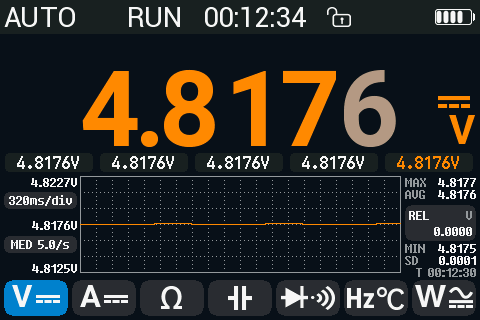

**Safety first.** opendm40 does not change the meter's input protection or
its ratings. Follow the safety rules and limits in Alientek's user manual.
opendm40 adds warnings for wrong connections ([Safety and
alerts](#safety-and-alerts)), but they cannot catch every mistake.

**Status.** opendm40 is experimental. It is developed on a DM40A and tested on
DM40A, DM40B and DM40C. What is untested on a real meter is listed in [Known
limitations](#known-limitations).

## Contents

1. [Getting started](#getting-started): install and update, keys, gestures,
   the main menu, the status bar, touch lock, battery and sleep.
2. [What's new compared with the stock firmware](#whats-new-compared-with-the-stock-firmware)
3. [Multimeter](#multimeter): every function, ranges, rate and resolution,
   HOLD, AutoHold, REL, MIN/MAX/AVG, limits, the bargraph and the trend
   chart, burden voltage.
4. [Safety and alerts](#safety-and-alerts): wrong-connection alerts, the
   danger alarm, the fuse check.
5. [Oscilloscope](#oscilloscope): timebase, V/div, triggers, cursors,
   measurements, FFT, Save CSV, and the [Wave view](#wave-view-the-scope-on-the-multimeter-inputs)
   on the multimeter inputs.
6. [Combined view](#combined-view): the multimeter and the scope on one
   screen; analog power.
7. [Signal generator](#signal-generator)
8. [Power meter](#power-meter): P, S, Q, PF, frequency, energy.
9. [Inrush current](#inrush-current)
10. [Recording](#recording): the Record page and the fast recorder.
11. [USB disk, screenshots and the gallery](#usb-disk-screenshots-and-the-gallery)
12. [Settings](#settings): every settings item, the Device page and the touch test.
13. [Remote control and connecting from a computer](#remote-control-and-connecting-from-a-computer):
    the phone app, USB and Bluetooth on Linux, Windows and macOS, sigrok.
14. [Backup, recovery and back to stock](#backup-recovery-and-back-to-stock)
15. [What is kept when you switch off](#what-is-kept-when-you-switch-off)
16. [Known limitations](#known-limitations)

Every SCPI command is in the separate [SCPI reference](scpi-reference.md).

## Getting started

### Install

Before you start:

- Charge the battery.
- Read [Back up your meter](#back-up-your-meter). The backup is made with
  opendm40 itself, after the install, and only takes a copy of a folder.

To install opendm40 on a meter that runs the stock firmware:

1. Download the update file `dm40_opendm40_v<version>.bin`, for example
   `dm40_opendm40_v0.2.0.bin`, from the latest
   [release](https://github.com/opendm40/opendm40/releases/latest). You can
   also build it from the source
   ([firmware/README.md, Build](../../firmware/README.md#build)).
2. On the meter: **Settings > Other Settings > USB Connect**. Connect the
   meter to the computer with a USB cable. A USB disk appears.
3. Copy the file onto that disk (any `dm40*.bin` name works). Keep it the
   only `dm40*.bin` file on the disk ([why](#install-a-file-from-the-update-loader)).
4. Eject the disk on the computer.
5. Switch the meter off and on again. The stock update procedure installs
   the file.
6. The first start takes a few seconds; opendm40 shows a progress bar. Do
   not switch the meter off in the first 10 seconds.

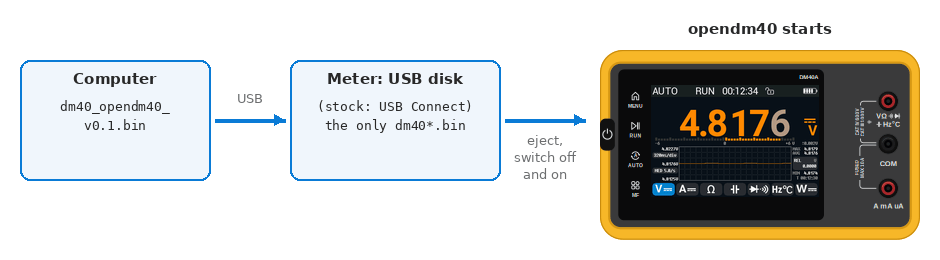

*Install: copy the file onto the stock firmware's USB disk, then restart.*


*Step 2 on the stock firmware: USB Connect.*

If the meter stops on the loader's update screen instead, install the file
from there ([Install a file from the update
loader](#install-a-file-from-the-update-loader)).

To try a change before its release: open [pull
requests](https://github.com/opendm40/opendm40/pulls) have a **Test build**
comment with the update file (all of them: [PR test
builds](https://github.com/opendm40/opendm40/releases/tag/pr-builds)); its
version reads like `0.3.2-pr148.1a2b3c4`. These builds are not tested on a
meter.

### Update

To install a newer opendm40 (or any other DM40 update file) from a running
opendm40:

1. **Settings > More > More > USB disk**: tap until it reads
   **PC can edit (re-plug)**.
2. Unplug the USB cable and plug it in again. The disk is now writable.
3. Copy the update file onto the disk, into the top folder
   (`dm40_opendm40_v<version>.bin`; any `dm40*.bin` name works).
4. The meter checks the file and asks **Firmware received. Install it
   now?** Tap **Yes**. The meter restarts into the update loader, installs
   the file and starts the new firmware.

If you do not answer within 60 seconds, the answer is No and the file is
deleted. A file that is not a DM40 update file is refused with **Not a DM40
update file**.

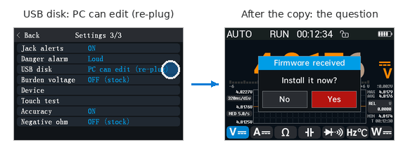

*Steps 1 and 4: the USB disk row, the install question.*

### Keys

The DM40 has four touch keys left of the screen and one power key on the left edge.

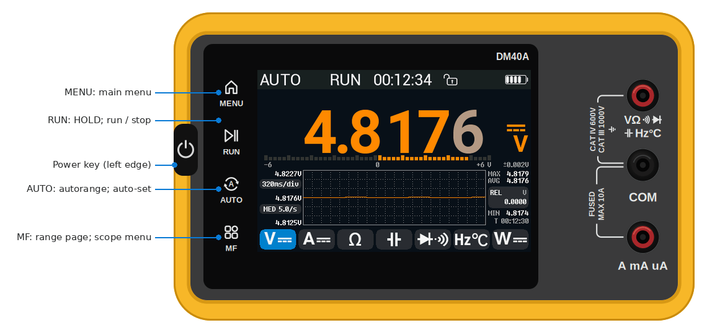

*The four touch keys and the power key.*

| Key | What it does |
|---|---|
| **MENU** | Opens the main menu. On a settings page: goes one page back. In the main menu: back to the instrument you came from. |
| **RUN** | Multimeter: HOLD on / off. Hold it for 1 s: AutoHold on / off. Scope: run / stop. Generator: output on / off. |
| **AUTO** | Multimeter, voltage, current and resistance: in autorange, fixes the present range; each further press steps to the next higher range, from the highest back to the lowest (60 mV and 60 Ω included). Hold it for 1 s: back to the default autorange (AUTO+ on volts, AUTO on current and resistance). Both clear HOLD and REL; AutoHold stays as it is. The other multimeter functions: back to autorange. Scope: auto-set. |
| **MF** | Multimeter: the range page of the function. Scope: the scope menu. |
| **Power** | Press: switches the meter on, or wakes a dimmed screen. Hold 1.5 s: the screen goes dark and the meter beeps; it switches off when you let go. Press twice quickly: touch lock on / off. |

Every key press also silences the [danger alarm](#the-danger-alarm).

### Gestures

| Gesture | Where | What it does |
|---|---|---|
| Swipe left / right | Multimeter, combined view (start on the meter strip), generator | Next / previous view |
| Swipe down with one finger | Multimeter | Start / stop a [recording](#recording) |
| Swipe down with three fingers | Anywhere, while the touch lock is off | [Screenshot](#screenshots) to the disk |
| Swipe down with two fingers | Anywhere, while the touch lock is off | Asks **Power off?** Tap **Yes** to switch off. The question goes away by itself after 3 s. |

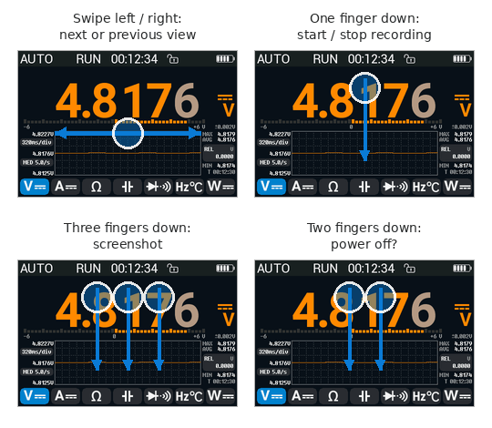

*The gestures.*

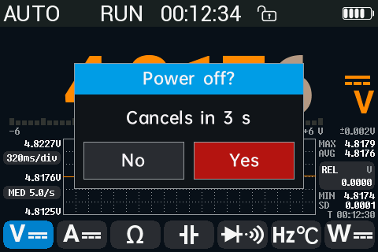

*Swipe down with two fingers: the power-off question.*

The oscilloscope has its own drags and taps; see
[Moving things with a finger](#moving-things-with-a-finger).

### The main menu and the views


*The main menu.*

The main menu has six tiles:

- **Gallery: screenshots and logs**: the screenshots and Record-page
  recordings stored on the meter ([The gallery](#the-gallery)).
- **Multimeter** ([Multimeter](#multimeter)).
- **Oscilloscope** ([Oscilloscope](#oscilloscope)).
- **Signal**: the signal generator ([Signal generator](#signal-generator)).
- **Settings** ([Settings](#settings)).
- **Combined view: DMM + Scope**: the meter reading above the live scope
  ([Combined view](#combined-view)).

The four instrument views follow each other in this order:

**Multimeter → DMM + Scope → Oscilloscope → Generator → Multimeter**

On the multimeter, the generator and the combined view (start on the meter
strip there), swipe left for the next view and right for the previous one.
On the oscilloscope page a drag moves the trace, so a swipe does not change
the view: leave it with **MENU**, or switch on **Settings > More > Scope
swipe**, which lets a swipe that starts on the top bar or the side panel
change the view.

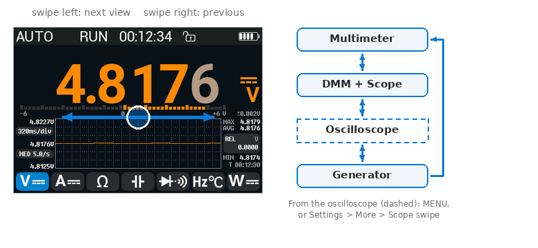

*A swipe changes the view; from the oscilloscope only with MENU or Scope swipe.*

### The status bar

The top line of the multimeter page shows, from left to right:

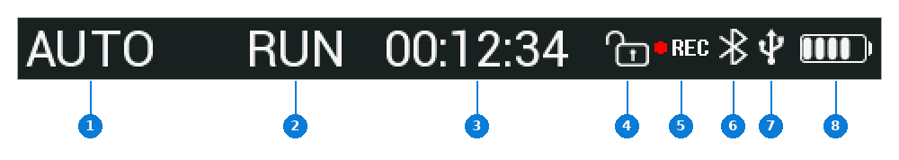

*The status bar.*

1. the range: **AUTO** or **AUTO+** while the meter picks the range, or
   the fixed range itself, e.g. **6V**, **600mV**, **60mA**, **6KΩ**
   (as the stock firmware shows it);
2. **RUN**, **HOLD** or **A-HOLD**, or in that place a wrong-connection
   [alert](#safety-and-alerts);
3. the time since the meter was switched on (hours:minutes:seconds);
4. a lock symbol: open, or closed while the touch lock is on;
5. a red dot and **REC** while a recording to the disk runs; the dot blinks;
6. the Bluetooth symbol while a phone or a computer is connected over
   Bluetooth;
7. the USB symbol while a computer has the meter connected (not with a charger);
8. the battery level; green on the charger: the top bar blinks while the battery charges and stays when it is full.

### Touch lock

To lock the screen and the touch keys (for example in a pocket): press the
power key twice quickly. The lock symbol in the status bar closes. Press
twice again to unlock.

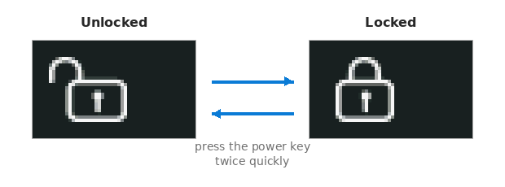

*The lock symbol, open and closed.*

While the lock is on, a single press of the power key on the multimeter or
the combined view switches to the next sub-mode of the current function
(for example DC V → AC V), as on the stock firmware.

### Power, battery and sleep

- **Dim screen** (Settings, default 5 min): without a touch or a key press
  for this long, the backlight dims. Any touch or key brings it back; that
  first touch only wakes the screen and does nothing else.
- **Shutdown** (Settings, default 30 min): without input for this long, the
  meter switches off. 30 s before, it beeps and shows **Auto power-off in
  30 s** (then 20, 10); touch the screen or press a key to keep it on.
- A connected computer or phone also keeps the meter on: any SCPI command
  over USB or Bluetooth, a phone-app request, and the computer reading or
  writing the USB disk count as use for **Shutdown**, so the meter does not
  switch off in the middle of a remote session or a firmware update. They
  do not count for **Dim screen**: during a long remote session the screen
  still dims, and they do not light it up again.
- The meter does not switch itself off while a recording runs, while a
  MIN/MAX/AVG session runs, or while the power meter counts energy with a
  current flowing. The screen still dims.
- To switch off: hold the power key 1.5 s, or swipe down with two fingers
  and tap **Yes**.
- The battery charges from the USB port.

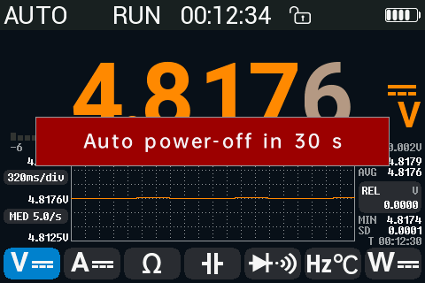

*The warning 30 s before the automatic power-off.*

### On-screen help

**Settings > More > Help** opens two short help pages: gestures and side
keys. Tap to turn the page.

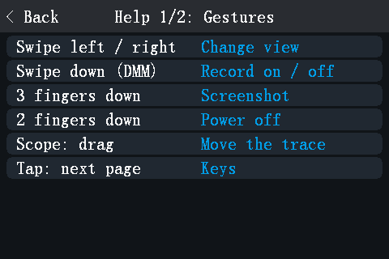

*The first help page: gestures.*

## What's new compared with the stock firmware

opendm40 replaces the stock firmware V2.6. It keeps its look, its touch
control and its Bluetooth phone-app protocol. This part lists what is
different; the details are in the sections linked.

#### Everything at once

The multimeter, the scope and the generator run at the same time; on the
stock firmware only the generator keeps running, with the scope. The
[combined view](#combined-view) shows the multimeter reading above the live
scope.


*The combined view: the multimeter, the scope and the generator at once.*

#### In the multimeter

| | Stock | opendm40 |
|---|---|---|
| Counts | By model: 40000 (DM40A, 400 mV, 4 V ...), 50000 (B), 60000 (C) | [60000 on every model](#counts-rate-and-the-extra-digit) (the hardware is the same); ranges 600 mV, 6 V ... |
| AC+DC | DM40B and C only; the first value can be computed from the DC part alone | Every model; shown only when both parts are measured, with the AC and DC parts |
| AUTO coupling | — | Shows the DC or the AC part, whichever the signal is |
| Volt autorange | Starts on mV | **AUTO+** by default: never steps down to mV |
| Speed | Fixed | [FAST / MED / SLOW](#rate-fast-med-slow) |
| Resolution | 60000 counts at most | An [extra digit](#counts-rate-and-the-extra-digit) (600000 counts) in MED and SLOW |
| Smoothing | — | Optional [smoothing](#smoothing) of the display |
| AutoHold | — | [AutoHold](#autohold): holds a stable reading by itself |
| Limits | — | [Limits](#limits-and-autohold): **OK**, **HI** or **LO** next to the reading, a fail beep |
| AVG | — | The [mean](#min-max-avg) next to MAX and MIN |
| Statistics session | — | A [MIN/MAX/AVG session](#min-max-avg) with a timer; no automatic power-off while it runs |
| Bargraph | — | A 50-segment [bargraph](#the-bargraph-and-the-history-row), by default |
| Temperature sensors | K thermocouple | Also [PT100, PT1000, three NTCs and a user NTC](#temperature) |
| Temperature offset | — | An offset per sensor |
| °F | Multiplies by 1.82 instead of 1.8: at 100.3 °C it shows 214.5 °F | °F computed correctly (212.5 °F), on the screen and over Bluetooth |
| 4-20 mA % | Always shown, also negative | Labelled, shown only in the useful range |
| 60 mV range | Not on the range page, never chosen by AUTO | On the range page; AUTO steps into it |
| 60 Ω range | Never chosen | On the range page; AUTO steps into it (0.90 mA only) |
| Burden voltage | — | Optional |
| Accuracy of the reading | — | [Shown](#accuracy) under the unit |
| Function change | The old value or 0.0000 under the new unit | Grey dashes at once, grey until the value is final |
| History while HOLD | Cannot store the held value | Stores it |

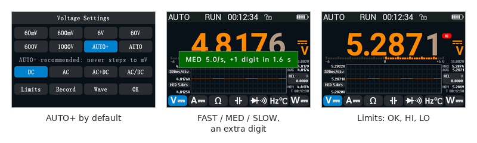

*AUTO+, the rate, limits.*

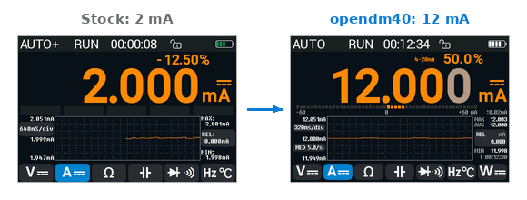

*4-20 mA: at 2 mA the stock shows -12.50 % without a label; opendm40 labels the percentage and hides it below 3.6 mA.*

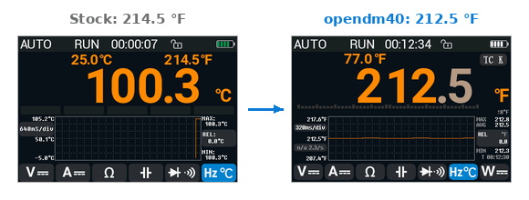

*°F at 100.3 °C: 214.5 °F on the stock, 212.5 °F on opendm40.*

#### New instruments

- The [power meter](#power-meter): P, S, Q, PF, frequency, Wh, VAh; DC, AC
  or AC+DC; the DC and AC parts.
- [Inrush current](#inrush-current): the RMS of the first 100 ms and the
  peak of a switch-on current, saved to the disk.
- The [Wave view](#wave-view-the-scope-on-the-multimeter-inputs): the
  oscilloscope on the isolated multimeter inputs.

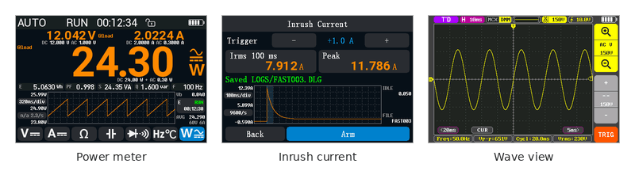

*The power meter, inrush current, the Wave view.*

#### Safety

The stock firmware has only the high-voltage warning (red from 30 V,
lightning from 100 V). opendm40 adds:

- [alerts for wrong connections](#the-alerts) (A-JACK, V-JACK?, LIVE? and
  the hints);
- protection of the small current shunt (**A-PROT**, **OVLD**);
- a loud [danger alarm](#the-danger-alarm);
- a [fuse check](#fuse-check).

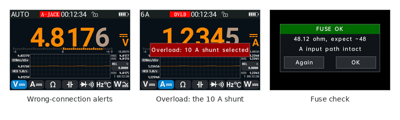

*Alerts, the overload move to the 10 A shunt, the fuse check.*

#### In the oscilloscope

| | Stock | opendm40 |
|---|---|---|
| Top bar | Not touchable | Tap the run state, timebase, V/div, trigger |
| Timebase taps | Tap the left or right half | [Corner zones](#timebase) with labels (or the stock halves) |
| Timebase list | — | Tap the timebase in the top bar |
| Pinch | — | Pinch to change the timebase or the V/div |
| V/div buttons | The top "+" made the trace smaller | Magnifier icons: the top one zooms in |
| Trigger position | Always the centre | Drag it |
| Triggers | Edge | Edge, pulse width, runt; the generator as a trigger source |
| Channels | CH1 | CH1, the multimeter input as CH2, the generator's output (computed) |
| Auto-set | Switches AC coupling to DC | Keeps AC coupling |
| Cursors | Through the Measure tab | One tap on **CUR** |
| FFT readouts | No scale | [Scale, centre frequency and peak readout](#fft) |
| FFT windows | — | Also Flat-top |
| Capture length | 65 520 samples | up to 45 056 samples |


*The touchable top bar.*


*The timebase corner tabs and the CUR tab.*


*V/div: the magnifiers; the top one zooms in.*


*Corner taps, the trigger position drag, cursors in one tap.*


*The Trigger tab: pulse and runt types.*


*FFT: scale, centre frequency and the peak.*

#### In the generator

| | Stock | opendm40 |
|---|---|---|
| Sine / triangle / ramp above 50 kHz | Output stops without a message | Runs at 50 kHz, with a note |
| Square 50 to 100 kHz | Snapped down to 50 kHz | The nearest frequency the hardware can make |
| Shown frequency | The typed value | The real output frequency |
| Ramp | Falls, against its icon | Rises |
| Amplitude | 0.5 to 3 Vpp | 0 to 3 Vpp |
| Offset | Fixed | [Adjustable](#offset) |
| DC output | — | 0 Vpp with an offset |
| Runs | With the scope page | On every page |

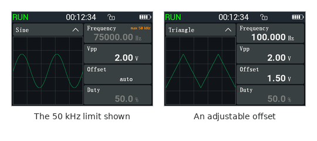

*The 50 kHz limit shown; a triangle around 1.5 V.*

#### Data, USB and Bluetooth

| Stock | opendm40 |
|---|---|
| No logging | The [Record page](#the-record-page): every reading, or means per 1 s to 1 min, for hours |
| — | A [fast recorder](#fast-recording) of raw samples |
| USB disk only in the **USB Connect** mode | The [disk](#the-usb-disk) and a SCPI instrument at the same time, with CSV files, screenshots and backups |
| — | SCPI over USB (USBTMC) and Bluetooth |
| Phone app over Bluetooth on the multimeter page | Phone app in every view |
| — | A [gallery](#the-gallery) of screenshots and recordings on the meter |

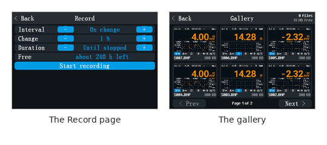

*The Record page and the gallery.*

#### Other

- A warning 30 s before the automatic power-off.
- [On-screen help](#on-screen-help).
- The [Device page](#the-device-page) shows the opendm40 version and the
  board temperature.

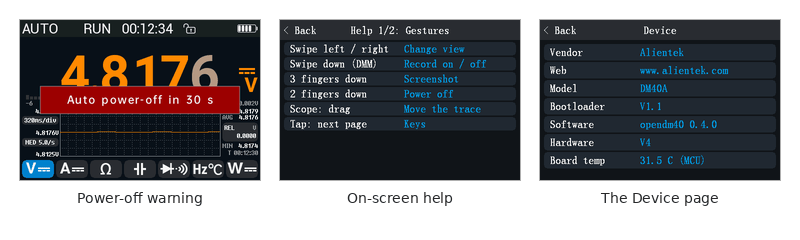

*The power-off warning, the help, the Device page.*

#### What the stock firmware has and opendm40 does not

- Chinese menus: opendm40 is English only.
- The longer scope capture (65 520 samples).

## Multimeter

### The multimeter page


*DC V with the bargraph.*

From top to bottom:

- the [status bar](#the-status-bar);
- the reading, with the unit and the coupling symbol on the right, and up to
  two small values above it (for example the frequency and the duty cycle);
- a row with the [bargraph or the last five stored
  readings](#the-bargraph-and-the-history-row);
- the [trend chart](#the-trend-chart), with its timebase and the rate on the
  left, and MAX, AVG, REL and MIN on the right;
- seven function buttons: **V**, **A**, **Ω**, capacitance,
  diode / continuity, **Hz / °C** and **W** (the [power meter](#power-meter)).

### Choose a function

Tap a function button. Tap the selected button again for its next
sub-mode:

| Button | Sub-modes, in tap order |
|---|---|
| **V** | DC → AC → AC+DC → AUTO (AC/DC) → DC |
| **A** | DC → AC → AC+DC → AUTO (AC/DC) → DC |
| **Ω** | Test current 0.90 mA → 0.28 mA (ON) → 0.90 mA |
| Capacitance | (none) |
| Diode / continuity | Diode → Continuity → Diode |
| **Hz / °C** | Frequency → Temperature → Frequency |
| **W** | Power meter: DC → AC → AC+DC → DC |


*The function buttons and their sub-modes.*

A function always starts in autorange; V and A start in DC, the diode
button starts on diode, the Hz / °C button on frequency. The coupling can
also be chosen on the [range page](#ranges-the-range-page-mf).

Right after a change, the new unit appears at once and the value shows grey
dashes. Values that are not final yet (the first reading, while the range
is being found) are grey. Only final (white or orange) values go into
statistics, REL, limits, the chart, recordings and readings over USB or
Bluetooth.

### Functions

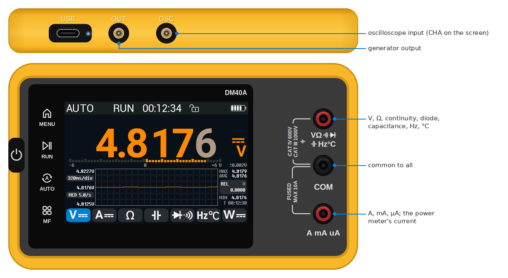

*The jacks: V Ω, COM and A on the front, OUT and OSC on the top edge.*

#### DC and AC voltage

- DC V: the signed voltage.
- AC V: the true RMS voltage, with the frequency and the duty cycle above
  it.
- Ranges: 60 mV, 600 mV, 6 V, 60 V, 600 V, 1000 V.
- From 30 V the value turns red; from 100 V a lightning symbol appears.

There is no separate mV button: choose the 60 mV or 600 mV range on the
range page, or use AUTO (not AUTO+), which steps down into mV. AUTO goes
from 600 mV to 60 mV below 58.3 mV and back above 61.8 mV. The 60 mV range
shows no extra digit.

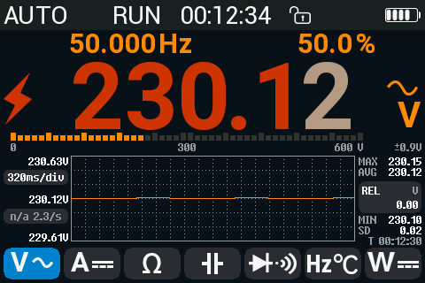

*AC V on the mains: red from 30 V, the lightning from 100 V.*

#### AC+DC

For signals with both a DC and an AC part, for example a ripple on a supply
rail. The meter measures the AC part and the DC part one after the other and
shows:

- the total, √(AC² + DC²), as the main value;
- the AC part (left) and the DC part (right) above it.

One full cycle takes about 2 s; the first value comes after about 1.3 s.
Until both parts are measured, the parts are grey. After a range change the
meter waits for the AC part to settle. There is no rate choice and no extra
digit in AC+DC.

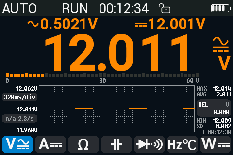

*AC+DC: 12 V with 0.5 V ripple; the AC part and the DC part above.*

#### AUTO coupling (AC/DC)

AUTO coupling shows the DC part or the AC part, whichever the signal is:

- a DC voltage with a little ripple: the DC value, signed;
- an AC voltage with little DC: the RMS of the AC part.

The coupling symbol above the unit shows which part you see, with **AUTO**
above it. Both parts are always shown above the reading.

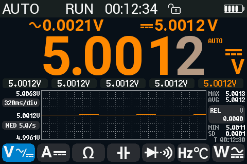

*AUTO coupling on a DC source.*

- AUTO switches to AC when the AC part is more than 1.5 times the DC part
  and above a floor (1 % of the range for volts, 3 % for amps). It switches
  back to DC when the AC part falls below 0.75 times the DC part or below a
  lower floor (0.5 % for volts, 2 % for amps).
- A switch takes 2 to 4 s (two cycles in a row must agree).
- Open leads read DC. Mains hum picked up by open leads can read as AC.
- When AUTO switches, REL and MIN/MAX/AVG restart.

#### Current: A, mA, µA

All current ranges use the **A** jack and **COM**. The meter switches the
shunt inside.

- Ranges: 600 µA, 6000 µA, 60 mA, 600 mA, 6 A, 10 A.
- DC A: the signed current. In the mA ranges the value above it shows the
  **4-20 mA** loop percentage: 4 mA = 0 %, 20 mA = 100 %. It is hidden below
  3.6 mA and above 125 %.
- AC A: the RMS current, with frequency and duty cycle.
- Optional: the [burden voltage](#burden-voltage).

The A function starts on a mA range in autorange. In AUTO, a current too
large for the µA or mA ranges moves straight to the 6 A range. On a fixed µA
or mA range, an overload moves the meter to the 10 A shunt and shows
[**OVLD**](#overload-the-10-a-shunt).

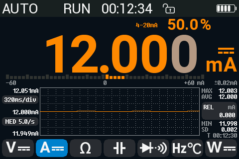

*DC mA in a 4-20 mA loop: 12 mA is 50 %.*

#### Resistance

- Ranges: 60 Ω, 600 Ω, 6 kΩ, 60 kΩ, 600 kΩ, 6 MΩ, 60 MΩ (and an
  experimental 600 MΩ, below). 60 Ω shows
  milliohms and always uses 0.90 mA; AUTO goes there only with 0.90 mA.
- Two test currents. **0.90 mA** (the default) and **0.28 mA ON** (second
  tap on Ω, or **0.28 mA ON** on the range page): the smaller one is for
  measuring in a circuit. With 0.28 mA the Ω button shows a small **ON**
  tag.
- Top left, small: the test current of the selected range, for example
  **I 197 uA** on 6 kΩ. It is the short-circuit current, the most the range
  drives through the leads; with a resistor between them it is less. On
  60 MΩ nothing is shown (not measured yet).

  | Range | 600 Ω | 6 kΩ | 60 kΩ | 600 kΩ | 6 MΩ | 60 MΩ |
  |---|---|---|---|---|---|---|
  | 0.90 mA | 0.90 mA | 197 µA | 20 µA | 2.2 µA | 0.22 µA | — |
  | 0.28 mA ON | 0.28 mA | 58 µA | 6.6 µA | 0.66 µA | 86 nA | — |

  Short-circuit currents measured on one unit with `DBG:SRC`, jacks
  shorted ([device check](../history/device-check-2026-10-21.md#ohm-test-current-map-dbgsrc)).
  The open-circuit voltage on 600 Ω is about 2.1 V (0.67 V with ON).
- While the meter looks for the range, the values are grey.
- **600MΩ experimental** (range page only, never AUTO): a reading per ~2 s,
  no accuracy spec. After power-up leave the leads open once: it learns its own leakage.


| 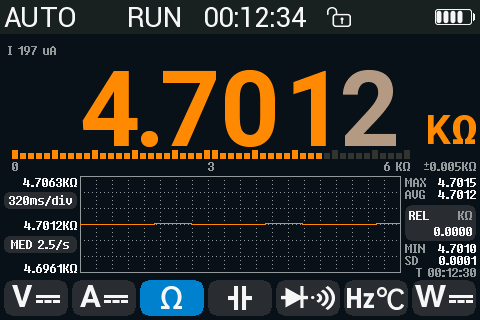 | 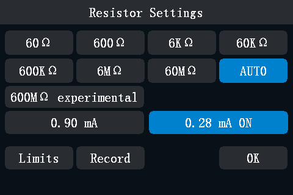 |
|---|---|
| 4.7 kΩ on 6 kΩ: test current 197 µA | The range page with 0.28 mA (ON) on |
| 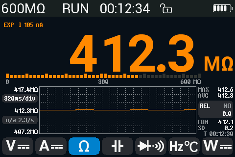 | 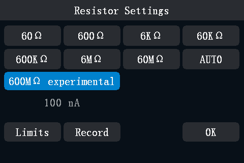 |
| The experimental 600 MΩ: test current 105 nA | The range page with 600 MΩ chosen |

#### Continuity

- Shows the resistance with two decimals; **0L** with **OPEN** above 1000 Ω.
- The beeper is driven by the measuring chip itself: its comparator watches
  the probe voltage and switches the beeper directly, with no firmware in
  between (the same chip setting as the stock firmware). It sounds while the
  resistance is below about 67 Ω (*inferred* from the chip setting). Silent
  at [Key/alert volume](#settings-page-1) 0 %.
- While it sounds (also at volume 0 %) a green **SHORT** band shows above the
  reading and the digits turn green, for at least 0.15 s.
- Top left, small: the test current, **I -0.26 mA** (the short-circuit
  current; negative: it flows the other way than in the diode test).
- The firmware adds no latch and no minimum beep length: the beep starts and
  stops with the contact.
- The comparator itself is fast (a bandwidth of a few MHz in the chip's data
  sheet). The time from a contact to the sound, and how short a contact is
  still heard, are untested on the meter.
- The reading updates every 50 ms while it changes, every 0.4 s once it is
  steady.
- A negative result means an external voltage on the circuit: the meter
  shows [**LIVE?**](#the-alerts).


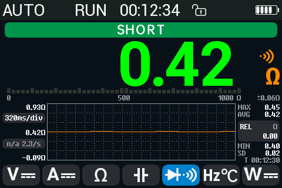

*Continuity: a short, the beeper sounds.*

#### Diode

- Shows the forward voltage with four decimals; **0L** with **OPEN** above
  3.12 V (open leads or a reversed diode).
- Top left, small: the test current, **I 0.76 mA** (the short-circuit
  current, measured on one unit; the open-circuit voltage is 3.2 V).
- Beeps by forward voltage, as on the stock firmware: a continuous tone
  below 22 mV (a short), three different beep patterns below 0.45 V,
  0.75 V and 1.5 V, silent above. A pattern plays for the first few
  readings only. Silent at Key/alert volume 0 %.
- The same green band while it beeps: **SHORT** below 22 mV, **BEEP** for a
  pattern.


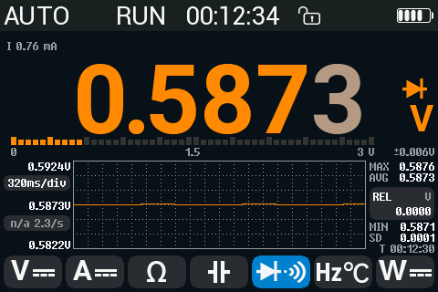

*A silicon diode.*

#### Capacitance

- Ranges: 6 nF to 60 mF, autorange only.
- Large capacitors take longer: from the 600 µF range up the meter first
  discharges, then measures.


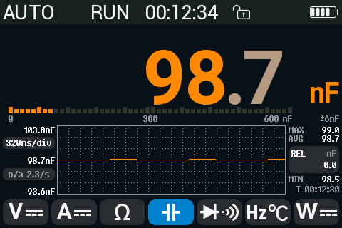

*A 100 nF capacitor.*

#### Frequency and duty cycle

- The frequency, with the duty cycle above it, from 0.5 Hz.
- A new value every 0.35 s; below about 7 Hz, one per one or two periods
  (about 1 s at 2 Hz).
- **--** until the first result; **0.000 Hz** when the signal stops.
- A small last digit where the counter resolves it: 10.0000 Hz, but
  50.000 Hz.
- MF opens the Hold & Limits page (there are no range choices).


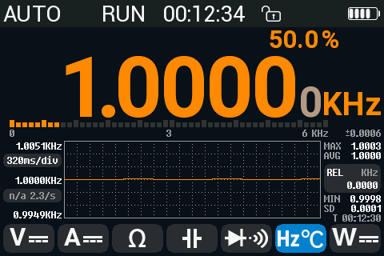

*1 kHz, 50 % duty.*

#### Temperature

Tap **Hz / °C** twice. Press **MF** to open the temperature page.

| 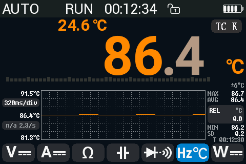 | 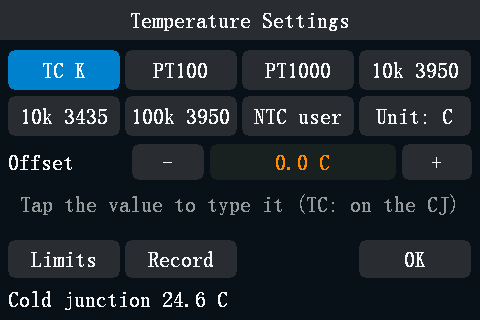 |
|---|---|
| Thermocouple K; the cold junction above | The temperature page |

| Sensor | Notes |
|---|---|
| **TC K** (type K thermocouple) | -40 to 1000 °C. The value above the reading is the cold-junction temperature (the meter's own sensor). About 2 s per reading. |
| **PT100**, **PT1000** | -200 to 850 °C, 2-wire. |
| **10k 3950**, **10k 3435**, **100k 3950** (NTC thermistors, B value 3950 or 3435) | -55 to 300 °C. |
| **NTC user** | Set **R25** (100 Ω to 10 MΩ) and **Beta** (1000 to 10000) with the keypad. |

| 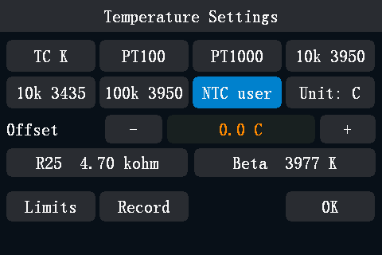 | 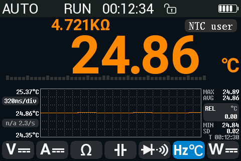 |
|---|---|
| NTC user selected: R25 and Beta below it | The reading; the sensor's resistance above it |

| 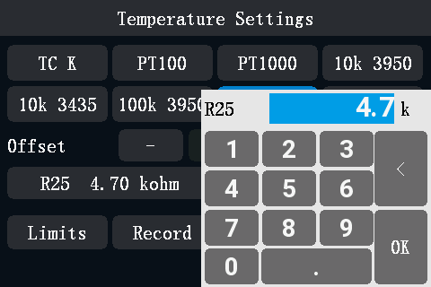 | 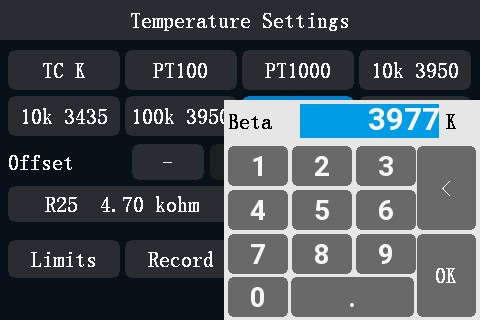 |
|---|---|
| Tap R25: the keypad, in kΩ | Tap Beta: the keypad, in K |

- The value above the reading is the sensor's resistance (resistive
  sensors) or the cold junction (TC K); the chip on the right names the
  sensor.
- **Offset**: -20 to +20 °C in 0.1 °C steps, one per sensor. Tap **-** /
  **+**, or tap the value to type it. For TC K the offset corrects the cold
  junction.
- **Unit: C** / **Unit: F** switches between °C and °F for the whole meter
  (also **Settings > More > Temp unit**).
- The 2-wire leads add their resistance: about 0.4 °C per 0.1 Ω on a PT100.
  Correct it with the offset or with REL.
- The supplied thermocouple is rated to 300 °C.

Owners report early units reading the thermocouple 3.6 to 6 °C low: set
the offset once.

### Ranges: the range page (MF)

Press **MF** to open the range page of the current function (for
continuity, diode and frequency, MF opens [Hold &
Limits](#limits-and-autohold)).

| 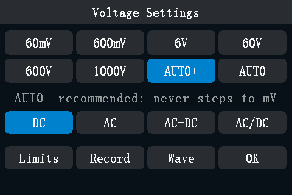 | 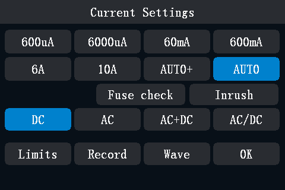 |
|---|---|
| The voltage range page | The current range page |

- Tap a range to fix it (the status bar shows the range, e.g. **60V**). Tap **AUTO** or
  **AUTO+** to return to autorange, or hold the **AUTO** key for 1 s.
- A short press of the **AUTO** key fixes the present range, or steps to
  the next higher one; after the highest comes the lowest (the
  [key table](#keys) has the details).
- The coupling row: **DC**, **AC**, **AC+DC**, **AC/DC** (AUTO coupling).
- **Limits** opens the [Hold & Limits page](#limits-and-autohold), **Record**
  the [Record page](#the-record-page) (red while recording).
- **OK** or **MF** goes back.
- Current page only: [**Fuse check**](#fuse-check) and
  [**Inrush**](#inrush-current).
- Voltage and current pages: **Wave** opens the oscilloscope on the
  multimeter inputs ([Wave view](#wave-view-the-scope-on-the-multimeter-inputs)).

Choosing a range turns REL off.

#### AUTO and AUTO+

| | Voltage | Current |
|---|---|---|
| **AUTO+** | Volt ranges only; never steps down to 600 mV. **Default.** | Steps down to the mA ranges, not to µA. |
| **AUTO** | Also steps down into 600 mV and 60 mV. | Steps down to µA. **Default.** |

With AUTO on volts, the range page warns in orange: **AUTO starts on mV:
AUTO+ is safer**.

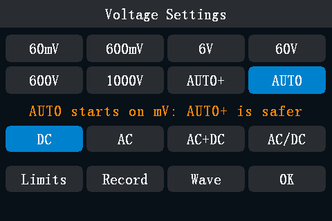

*AUTO selected on volts: the warning.*

AUTO+ is the default for volts because owners have linked damaged inputs
to a high voltage applied while the meter sat on the mV range.

#### Overflow

- **0L** in the reading with the word **Overflow** next to it: the value
  is above the range (or the function's limit). The bargraph turns red with
  an **OL** mark. On the scope page's meter strip, **Overflow** is in the
  small text right of the reading.
- Continuity and diode say **OPEN** instead of **Overflow** (also the
  bargraph mark).
- A small value (for example the diode's Ω value) that is over its limit
  shows **0L** with a small **Overflow** before it.
- An overflow is never stored in MIN/MAX/AVG, the chart or the history.


| 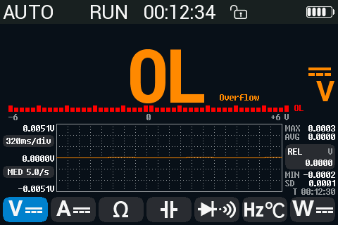 | 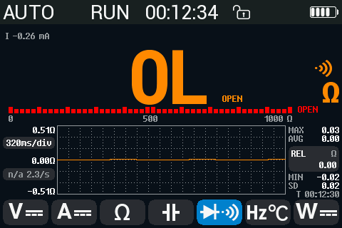 |
|---|---|
| Over range: 0L, Overflow | Continuity, open leads: 0L, OPEN |

### Counts, rate and the extra digit

opendm40 uses 60000 counts on every model (ranges 60 mV, 600 mV, 6 V ...).

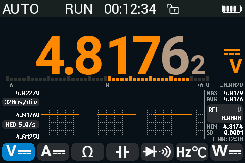

*4.8176 V and the extra digit, 2.*

#### Rate: FAST, MED, SLOW

The rate sets the speed and the resolution in DC V, DC mV, DC A and Ω:

| Rate | What you get |
|---|---|
| **FAST** | 10 readings/s, 60000 counts. In Ω: 5 readings/s. |
| **MED** (default) | 5 readings/s (Ω: 2.5/s). On suitable ranges, an average over 1.6 s gives an extra digit (600000 counts). |
| **SLOW** | 2.5 readings/s, with a 6.4 s average on every DC V, DC A and Ω range (the extra digit only on the ranges listed below). |

Every rate rejects 50 Hz and 60 Hz mains hum on a DC reading: each
conversion integrates the input over 100 ms (FAST, MED) or 200 ms (SLOW),
a whole number of periods of both.

In DC V, DC mV and DC A, FAST runs the converter without its built-in
offset cancellation (the chopper), which is what makes it twice as fast as
MED. The meter measures and subtracts that offset itself: 2 s after a
function or range change and then every 30 s, it reads the input once with
the opposite polarity. Each time two readings are skipped (a 0.2 s pause).
It takes the measurement only while the input is steady, and tries again
5 s later otherwise. Until the first measurement on a range, FAST uses the
last offset it measured on another range, so a reading in those first 2 s
can be a little off. A FAST reading is a little noisier than a MED one
(more low-frequency noise); for the extra digit use MED or SLOW.

In Ω from 60 Ω to 60 kΩ the averages are longer (MED 6.4 s, SLOW
12.8 s; no extra digit on 60 Ω). After a step of the input or a range change the average restarts,
so a change shows at once.

- The **rate chip** on the left of the chart shows the rate and the
  measured readings per second (**--/s** just after a change). Tap it:
  FAST → MED → SLOW → FAST.
- **Tap the reading** to step the rate the same way; a message says what you
  get, for example **MED 5.0/s, +1 digit in 1.6 s**.
- In the other functions (AC, AC+DC, capacitance, frequency, temperature,
  continuity, diode) the speed is fixed: the chip shows **n/a**; a tap on the
  reading shows **Fixed rate in this function**.
- Also in **Settings > More > DMM rate**.


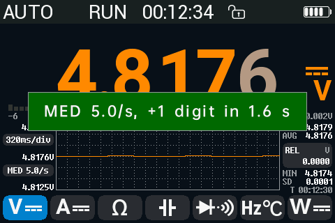

*A tap on the reading steps the rate.*

The extra digit appears smaller, after the main digits, on these ranges:
DC 600 mV, 6 V, 60 V, 600 V and Ω 600 Ω, 6 kΩ, 60 kΩ, about 1.6 s (MED in
DC) or 3.2 s (SLOW, and in Ω) after the input settles.

#### Smoothing

**Settings > More > Smoothing**: **OFF** (default), **LOW**, **HIGH**. A
moving average of the shown readings, for a calmer display. It restarts on a
real step, so changes still show at once. Smoothing applies to the reading,
the limits, the chart and readings over USB or Bluetooth; not to
MIN/MAX/AVG, AutoHold, recordings or the bargraph. Continuity is never
smoothed.


*Smoothing LOW in Settings, page 2.*

### HOLD, AutoHold and REL

#### HOLD

Press **RUN**. The status bar shows **HOLD**; the reading, the statistics
and the chart freeze. The bargraph keeps moving with the live input. Press
**RUN** again to release.

If you press RUN right after a function change, HOLD waits for the first
final reading and holds that.

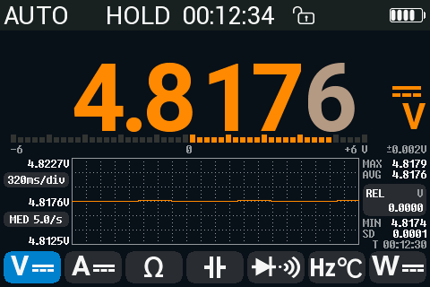

*HOLD.*

#### AutoHold

To switch AutoHold on or off: hold **RUN** for 1 s (or the first row of the
Hold & Limits page). The status bar shows **A-HOLD**: blue while it waits,
orange while it shows a captured value.

AutoHold captures a reading when it has been stable for about a second (for
example within 0.1 % for 1 s in DC V), beeps and keeps it on the screen
while you lift the probes. It captures again after the input went away (open
leads, OL) or changed by more than about 0.5 %. The statistics and the chart
keep running on the live value.

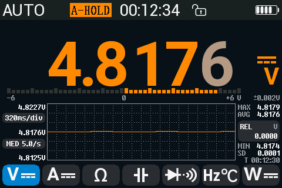

*AutoHold with a captured value.*

#### REL

Tap the **REL** box on the right. The current reading becomes the zero;
the box shows the REL value. Tap again to turn it off.

- REL works in every function. In V, A, Ω and Hz it also fixes the range.
- Not possible while HOLD is on or the reading is OL.
- REL ends when you change the function, choose a range, press AUTO, or
  AUTO coupling switches.
- Turning REL on or off restarts MIN/MAX/AVG.


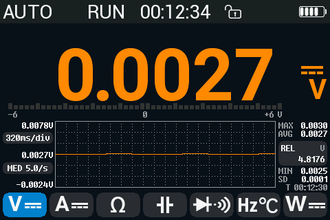

*REL: 4.8176 V is the zero.*

### MIN, MAX, AVG

The column on the right of the chart shows **MAX**, **AVG**, **MIN** and
**SD** (sample standard deviation) since they were last reset, and a timer
**T hh:mm:ss**.

- **Tap the column** (outside the REL box): start a session. The
  statistics are cleared, the timer turns orange, and
  the meter does not [switch itself off](#power-battery-and-sleep) while the
  session runs. Tap again to stop.
- **Long press the column**: reset MIN/MAX/AVG.


*A MIN/MAX/AVG session running for 5 min 12 s.*

### The bargraph and the history row

**Settings > More > DMM row** chooses what the row under the reading
shows: **Bargraph** (default) or **History**.

- **Bargraph**: 50 segments, each 2 % of the range; centre zero in DC V and
  DC A (25 segments per side, 4 % each), from zero elsewhere, empty in
  temperature. It updates with every measurement, without smoothing or REL,
  and keeps moving during HOLD.
- **History**: five boxes. Tap the row to store the shown value (also a held
  value); the newest is orange. Long press the row to clear it.


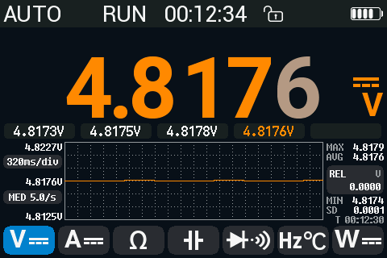

*The history row: four values stored.*

### Accuracy


Under the unit: the specified accuracy of this reading for the meter's
model ([details](../../firmware/docs/dmm-accuracy.md)). Digits finer than
it are grey. Not shown with the History row, in AC+DC, the 60 mV and 60 Ω
ranges, PT / NTC, the power meter or under REL. **Settings > More > More >
Accuracy** turns it off.

### The trend chart

The chart plots the reading over time, 321 points wide.

- Tap the left column of the chart (the timebase label) to switch
  160 → 320 → 640 ms/div → 1.28 → 2.56 s/div; the chart restarts.
- The scale follows the data.
- It stops during HOLD and keeps running during AutoHold.
- It restarts when you change the function or switch to a range with
  another unit (6 V to 600 mV).
- REL on or off does not restart it: the points from before stay, as in
  the stock firmware.

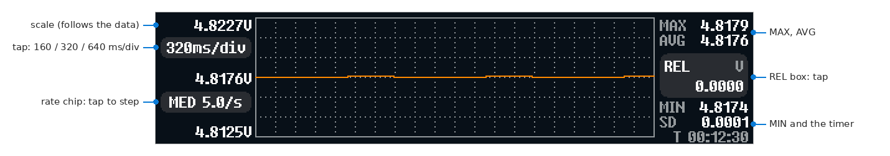

*The trend chart.*

### Limits and AutoHold

To open: **MF**, then **Limits** (for continuity, diode and frequency,
MF opens it directly). The title names the quantity, for example **Hold &
Limits: DC V**.

|  |  |
|---|---|
| Hold & Limits, DC V: 4.8 to 5.2 V | The reading above the upper limit |

| Row | What it does |
|---|---|
| **Auto Hold** | AutoHold on / off. |
| **Limits** | Limit check on / off. |
| **Upper limit**, **Lower limit** | Type a value with the keypad. |
| **Upper = reading**, **Lower = reading** | Take the current reading as the limit and switch the check on. |
| **Clear limits** | Remove both limits. |
| **Fail beep** | Beep when the reading leaves the limits (default ON). |
| **Record** | Opens the [Record page](#the-record-page). |

- Each quantity has its own limits: DC V, AC V, DC A, AC A, Ω, diode,
  capacitance, Hz, temperature, power. AC+DC uses the AC limits, continuity
  the Ω limits.
- The limits compare the shown value (after REL).
- Next to the reading: **OK** in green, **HI** or **LO** in red.
- The fail beep sounds when the reading crosses out of the limits, at most
  once per second.

### Burden voltage

A current meter drops a small voltage across its shunt (the burden
voltage), which the circuit under test loses. To show it: **Settings >
More > More > Burden voltage: ON (A, mA, uA)**. Default OFF.

- DC: the burden voltage above the reading, on the left, labelled
  **Burden**.
- AC: above the reading on the right, instead of the duty cycle.
- Not shown in AC+DC, AUTO coupling or the power meter.
- It is computed from the shunt resistance alone (10 mΩ for A, 0.5 Ω for
  mA, 47.5 Ω for µA); the fuse and the wiring add a little more.
- At full scale: 100 mV (10 A), 60 mV (6 A), 300 mV (600 mA), 30 mV
  (60 mA), 285 mV (6000 µA), 28.5 mV (600 µA).


*123.45 µA; the burden voltage, 5.9 mV, above it.*

## Safety and alerts

The stock firmware warns only about high voltage (a red value from 30 V, a
lightning symbol from 100 V). opendm40 keeps those and adds alerts for
wrong connections, a loud alarm for dangerous ones, and a fuse check.

The DM40 cannot see which jacks a plug is in. The alerts work from what the
meter measures, so they cannot catch every mistake ([What cannot be
detected](#what-cannot-be-detected)).

### How an alert looks

- A **badge** in the status bar, where **RUN** normally is (in the combined
  view: in the meter strip).
  - Red (white text): **A-JACK**, **A-PROT**, **OVLD**.
  - Amber: **V-JACK?**, **LIVE?**, **10A**.
  - Grey: the hints **DC?**, **AC?**, **FUSE?**.
- A **message** once, when the alert starts (1.5 s).
- During HOLD, A-JACK, A-PROT, LIVE? and OVLD alternate with **HOLD** every
  second.
- One alert at a time, the most serious one.


*A-JACK: current in the A jack while measuring DC V.*

### The alerts


*Measuring volts with the leads still in A and COM: A-JACK.*

| Badge | Message | When | Where |
|---|---|---|---|
| **A-JACK** | Current in A jack: check leads | A current (from about 0.5 mA) flows through the A jack while you measure something else, for example the leads are still in A and COM while measuring volts. | DC V (6 V range), DC mV, AC V, AC mV, Ω, continuity and diode (while they read 0L), temperature, capacitance 6 nF to 60 µF, AC+DC V (600 mV and 6 V). |
| **A-PROT** | A jack current: 10 A shunt on | The current through the A jack would overheat the small current shunt (300 mA at once, or 125 mA for 0.4 s). The meter switches the A jack to the 10 A shunt to protect it. | DC V, DC mV. |
| **OVLD**, then **10A** | Overload: 10 A shunt selected | On a fixed µA or mA range the current is too large: the meter moves to the 10 A shunt ([Overload](#overload-the-10-a-shunt)). | A functions and the power meter, fixed range. |
| **V-JACK?** | Voltage on V jack, no current | In a current function: no current, but a voltage on the V jack (DC above about 21 V, or AC from about 2 V). The leads may be in the wrong jacks. | Current functions (DC, AC, AC+DC, AUTO). |
| **LIVE?** | Voltage on circuit - power off | A reading only an external voltage can cause (a negative resistance), or in Ω and continuity a voltage on the V/Ω jack that would otherwise look like a current in the A jack (Ω: from about 3-5 V). | Ω, continuity, diode. |
| **DC?** | DC voltage here: use DC V? | AC V sees a DC voltage and almost no AC. | AC V; the power meter in AC+DC ([Coupling](#coupling-dc-ac-acdc)). |
| **AC?** | AC voltage here: use AC V? | DC V (6 V range) sees a voltage swinging both ways. | DC V; the power meter in DC. |
| **FUSE?** | 0 A for 60 s: check the fuse? | A current function read zero for a minute. The fuse may be blown. | A functions. |

How they end:

- A-JACK, LIVE?, DC?, AC?: 1 s after the cause is gone; V-JACK? and FUSE?
  after 0.5 s.
- A-PROT stays until you choose a function, a range or press AUTO, and the
  current is below 50 mA for 1 s. Choosing a current function ends it at
  once.
- OVLD / 10A: see [Overload](#overload-the-10-a-shunt).

Sounds: A-JACK and A-PROT sound the [danger alarm](#the-danger-alarm).
LIVE? beeps once. OVLD beeps once (300 ms). The others are silent.


*LIVE? in Ω: a voltage on the circuit.*

|  |  |
|---|---|
| A-PROT: the 10 A shunt protects the small one | V-JACK?: a voltage, no current |

|  |  |
|---|---|
| DC?: AC V sees a DC voltage | AC?: DC V sees an AC voltage |


*FUSE?: 0 A for a minute.*

**Settings > More > More > Jack alerts** chooses which alerts are on:
**ON** (all of the above, default), **A-JACK only** (A-JACK and A-PROT),
**OFF** (none of them, and no A-PROT protection). OVLD and the 10 A alarm
are always on.

### Overload: the 10 A shunt

All current ranges use the **A** jack. Behind it are one 10 A ceramic fuse
and three shunts in a row: 47 Ω, 0.5 Ω and 10 mΩ. Two MOSFETs choose the
shunt: on the µA ranges both are off (47.5 Ω); on the mA ranges one shorts
the 47 Ω (0.5 Ω); on the A ranges the other shorts both (10 mΩ). The order
of the parts and which MOSFET shorts what are *inferred* from the shunt
values and the parts list.


*The current path behind the A jack (the arrangement is inferred).*

**Why.** The fuse opens only around 10 A, and the 0.5 Ω and 47.5 Ω shunts
have no fuse of their own. Their heat grows with the square of the current:
0.3 A in the 47.5 Ω is 4.3 W, 2 A in the 0.5 Ω is 2 W. The ratings of these
resistors are unknown; about 1 W for the 47 Ω is *inferred*.

**When it trips.**

- On a fixed (manual) µA or mA range: in DC A, AC A, AC+DC A and AUTO
  coupling, and on a fixed current range of the power meter.
- When a reading is above 1.03 × the range (the reading is OL).
- At the first reading over the range: about 0.35 s after the overload in
  DC, about 0.75 s in AC (from the conversion and settling times; untested on
  the meter).

In autorange the same over-range is a normal range step: from the top µA or
mA range straight to the 6 A range, with no alert, beep or latch; above
6.18 A it steps on to 10 A.

**What the meter does.**

- It switches the A jack to the 10 mΩ shunt and the 10 A range at once, and
  keeps measuring there.
- One beep of 300 ms at the key/alert volume, the message **Overload: 10 A
  shunt selected** and the red badge **OVLD**. After 3 s the badge turns
  amber **10A**: the reading is right, but on the 10 A range, not yours.
- The µA and mA shunts stay out of use while the overload holds.
- Above 10 A for 1 s the [danger alarm](#the-danger-alarm) sounds as well.


*OVLD: the meter moved to the 10 A shunt.*

**How it ends.**

- You choose a range or a function, or press **AUTO**: it ends at once.
- Or the current stays below 85 % of the range you had chosen (at least
  2 mA) for 5 s: the meter goes back to that range by itself. An OL reading
  restarts the 5 s.
- If it trips again within 30 s of going back, it stays on 10 A until you
  choose a range or a function.

**Stock firmware.** The stock firmware has no such protection: on a fixed
µA or mA range it shows OL, and the current keeps flowing through the small
shunt (*inferred*: nothing in it switches the shunt on an overload).

**A-PROT** makes the same switch in the voltage functions, where leads left
in A and COM put the 47.5 Ω shunt across the source:

| | OVLD | A-PROT |
|---|---|---|
| Functions | A functions and the power meter, a fixed µA or mA range | DC V, DC mV |
| Trips at | a reading above 1.03 × the range | 300 mA at once, or 125 mA for 0.4 s, through the A jack |
| Sound | one 300 ms beep | the [danger alarm](#the-danger-alarm) |
| Ends | 5 s back in range, or your choice of range, function or AUTO | your choice of range, function or AUTO, and less than 50 mA for 1 s |
| Can be switched off | no | **Jack alerts OFF** turns it off |

### The danger alarm

A loud two-tone alarm for connections that can damage the meter or the
circuit:

- **A-JACK** in the functions where a current really flows through the A
  jack: DC V, DC mV, AC V, AC mV, thermocouple, AC+DC V. (In Ω, continuity,
  diode, capacitance and the resistive temperature sensors, A-JACK shows
  silently.)
- **A-PROT** while the current still flows.
- **A current above 10 A** for 1 s on the 10 A range (also in the power
  meter).

The pattern: high-low-high-low, once per second for 30 s, then once every
10 s until the cause is gone.


*A-JACK starts: the badge, the message and the alarm.*

To silence it (for this event): tap the badge or the message, or press any
key (the key still does its job), or the power key. A new event sounds
again.

**Settings > More > More > Danger alarm**:

- **Loud** (default): full volume, also when the key/alert volume is 0.
- **Volume**: at the key/alert volume.
- **Off**: badge and message only.

The alarm sounds only while the multimeter is powered.

### Fuse check

Checks the fuse and the current path inside the meter without opening it.

1. **A** function, **MF**, **Fuse check**.
2. Plug one test lead from the **V/Ω** jack into the **A** jack. Nothing
   else: remove the other lead.
3. Tap **Start**. The meter measures the path (about 48 Ω through the fuse
   and the shunts).


*Fuse check passed.*

| Result | Meaning |
|---|---|
| **FUSE OK** (about 48 Ω) | The fuse and the A input path are intact. |
| **FUSE OPEN** (OL) | No path from V to A: replace the fuse (10 A ceramic). |
| **Check leads** | A reading far from 48 Ω or none: one lead from V/Ω to A only. |

**Again** repeats, **OK** returns to the function you were in. Cancel or
any key stops it.

It cannot tell whether the 10 A shunt is intact: its 10 mΩ is lost in the
48 Ω.

### What cannot be detected

- A lead in the A jack with no current flowing.
- A voltage source across A and COM while you measure current: it reads as
  a current. Mains blows the fuse in under a millisecond.
- A blown fuse: the meter reads 0 A. FUSE? appears after a minute; the fuse
  check confirms it.
- A positive voltage below about 3 V on a circuit in Ω, or any positive
  voltage in diode: it looks like an open circuit. LIVE? needs a negative or
  alternating voltage there, or (Ω) about 3-5 V and more.
- A current in the A jack while a voltage is also on the V/Ω jack: Ω and
  continuity show LIVE?, AC mV shows nothing (the reading is over range).
  A-JACK shows only with the V/Ω jack free.


*Two cases no alert can see.*
- No A-JACK in DC V above the 6 V range (60 V, 600 V, 1000 V), in AC+DC V
  above 6 V, in frequency, and in the higher capacitance ranges. The power
  meter has no jack alerts.

## Oscilloscope

The oscilloscope input is the **OSC** jack on the top edge (**CHA** on the
screen). The [Wave view](#wave-view-the-scope-on-the-multimeter-inputs)
shows the signal on the multimeter inputs instead.


*The top edge: the OSC jack.*

To open it: main menu, **Oscilloscope**, or swipe from the combined view.


*The scope page: a 1 kHz sine, triggered.*

### The scope page


*The scope page.*

- **Top bar**, from the left: the run state, the timebase (**H 200us**),
  the record bar, the V/div with the probe and coupling, the trigger (edge
  and level), the Bluetooth symbol while a phone or a computer is connected
  over Bluetooth, the USB symbol while a computer has the meter connected,
  the battery.
  - Run state: **WAIT** (waiting for a trigger), **AUTO** (no trigger, frame
    shown anyway), **T'D** (triggered), **RUN** (roll), **STOP**.
  - Record bar: while stopped, brackets show which part of the stored
    record is on screen; **ROLL** in roll mode; **G 1.00kHz** while the
    [generator](#signal-generator) runs.
  - **MCX | DMM**: the input source (MCX is the **OSC** jack); tap to
    switch to the [Wave view](#wave-view-the-scope-on-the-multimeter-inputs).
- **Graph**: 10 × 8 divisions. On the left edge, the markers **A** (the
  trace's zero) and **M** (math / FFT); on the right edge, **T** (trigger
  level). On the top edge, **T** marks the trigger position.
- **Timebase tabs** in the bottom corners of the graph, for example
  **<500us** and **100us>**: the next slower and faster timebase.
- **CUR** tab at the bottom of the graph: cursors.
- **Right panel**: zoom in (magnifier +), **CHA** with the V/div, zoom out
  (magnifier −), the math scale +, the math button (**FFT**), math scale −,
  **TRIG**.
- **Measurement row** at the bottom: up to four measurements.

| Key | What it does |
|---|---|
| **RUN** | Run / stop. Also: tap the run state in the top bar. |
| **AUTO** | [Auto-set](#auto-set). |
| **MF** | The scope menu, Measure tab. |
| **MENU** | Main menu. Also closes a popup. |

### Timebase

- Range: 100 ns/div to 50 s/div. Up to 50 MS/s.
- **Tap a corner** of the graph: bottom left = slower, bottom right =
  faster. Keep the finger on the corner to repeat. The timebase in the top
  bar flashes on every change.
- **Tap the timebase** in the top bar: a list with each entry's sample
  rate (e.g. **200us 12.5MS/s**); drag to scroll, tap to choose.
- **Pinch** horizontally with two fingers: spread = faster, pinch = slower.
  A bubble shows the new value; it applies when you lift the fingers.
- **Roll mode**: from 200 ms/div the trace scrolls continuously (on by
  default; **MF > Display > Roll**). Without roll, the slowest timebase is
  1 s/div. Roll-only timebases are orange in the list.


|  |  |
|---|---|
| A tap on the bottom-left corner: one step slower | The timebase list |

**Settings > More > Scope tap step** sets which taps step the timebase:
**Corners** (default, only the two corners step), **Halves (stock)** (a tap
in the left or right half of the graph steps), **Off**.

### Vertical: V/div, position, coupling, probe

- V/div: 10 mV to 10 V per division (times the probe factor).
- Tap the **magnifier +** to zoom in (smaller V/div), **magnifier −** to
  zoom out. Or pinch vertically.
- **Drag up or down** in the graph to move the trace.
- Tap **CHA** (or the V/div in the top bar) for the channel popup:
  - **Coupling**: DC or AC.
  - **Probe**: ×0.1 to ×1000 (13 steps). It only changes the labels and
    readings, not the hardware.
  - **Color** of the trace.
- Bandwidth: owners report flat to about 3 MHz.


|  |  |
|---|---|
| Zoomed in: 500 mV/div | The channel popup: coupling AC |

### Trigger

- **Drag** the **T** marker on the right edge up or down to set the
  trigger level.
- The trigger level is kept in volts: changing the V/div, the probe or the
  position moves its marker, not the level. A level off screen shows its
  marker on the edge.
- **Drag sideways** to move the trigger position (the **T** on the top
  edge).
- **Long press** a marker to centre it: the trigger level goes to the middle
  of the signal, the trigger position to the centre, the trace to 0 V in the
  centre.
- **Double tap** where a tap does nothing: the trace to the centre and the
  trigger position to 50 %.


|  |  |
|---|---|
| Dragging the trigger level: T on the right edge | Dragging the trigger position: T on the top edge |

Open the Trigger tab: tap **TRIG**, or the trigger in the top bar.

| Item | Choices |
|---|---|
| **Edge** | Rising, Falling. |
| **Mode** | **Auto** (shows the signal also without a trigger), **Normal** (waits for a trigger), **Single** (one frame, then STOP). Choosing a mode also starts the scope. |
| **Type** | **Edge**, **Pulse**, **Runt**. |
| **Source** | **CH1**, or **GEN**: the generator's own output. |


|  |  |
|---|---|
| The Trigger tab | Pulse: wider than 400 µs |

- **Pulse**: triggers on a pulse wider than (**>**), narrower than
  (**<**) or equal to (**=**, within 5 %) a width. Set the width with
  **-** / **+**, 20 ns to 10 s. Rising = a positive pulse.
- **Runt**: triggers on a pulse that crosses the first level but not the
  second. Drag the orange **T** on the left edge to set the second level.
- Pulse and runt triggers look at each complete capture; a pulse in the
  short gap between captures can be missed. They do not work in roll mode.

The edge trigger uses the trigger hardware where it can, so it does not miss
edges between captures.

**Source GEN** triggers on the generator without a wire: the meter knows
from the generator's timers when its output crosses the trigger level, and
places the trigger there. The level is in the generator's volts (0 to
3 V; a square above 50 kHz switches between 0 and 3 V); a level outside
the output's swing never triggers. It is an edge trigger (Rising / Falling);
the trigger badge turns cyan. Useful when the circuit's response to the
generator is on CH1 and too noisy or too small to trigger on. With the
generator off, nothing triggers (Auto still shows frames). SCPI
`TRIGger:SOURce GENerator`.


*Runt trigger: the second level, the orange T.*

### Moving things with a finger


*Drags: the trigger level, the trigger position, the trace.*

A drag moves one thing along one axis until you lift the finger. The first
movement (about 8 pixels) decides the axis, and the axis decides what moves:

- **Up or down**: the level marker nearest to where the finger went down
  (the trace, the trigger level, the runt level, a Y cursor, the math / FFT
  offset), however far it is. A level off screen counts at its marker on the
  edge.
- **Sideways**: the time marker nearest to where the finger went down (the
  trigger position, an X cursor, the FFT centre). On a stopped scope, moving
  the trigger position pans the stored record.
- What is selected does not matter; the moved marker becomes the selection.
  When two markers are equally near, the one drawn on top moves.

A tap on a marker selects it; a tap on the selected marker selects the next
one under the finger.

**Settings > Scope drag** sets how a drag starts:

- **Stock** (default) and **Axis lock**: the drag moves as soon as the
  finger moves.
- **Hold 300 ms**: hold the finger still first; the meter beeps, then the
  drag moves.

A second finger during a drag undoes it.

### Auto-set

Press **AUTO**. The scope looks for a signal and sets the V/div, the
position, the trigger level (middle of the signal) and the timebase (about 2
to 6 periods on screen). It takes 1 to 2 s and leaves the trigger mode on
Auto. **MENU** cancels (the old settings come back) and opens the main
menu.

- AC coupling stays AC. Only if nothing is found in AC does it switch to DC
  and say **AUTO: DC (no AC signal)**.
- Nothing found: **AUTO: no signal found**, the settings stay.


|  |  |
|---|---|
| After auto-set on a 1 kHz square | Auto-set found nothing |

### Measurements

Press **MF**: the **Measure** tab lists 20 measurements. Tap up to four;
tap a selected one to remove it. **Clear** removes all, **Default**
restores Freq, Vp-p, Cycl, Vrms.


*The Measure tab.*

| Item | What it is |
|---|---|
| **Freq** | Frequency. |
| **+Duty**, **-Duty** | Positive and negative duty cycle. |
| **+Wid**, **-Wid** | High and low time of a cycle. |
| **+Pul**, **-Pul** | Number of high and low pulses on screen. |
| **X2-1** | Time between the X cursors. |
| **Xf** | 1 / (X2-1). |
| **Cycl** | Period. |
| **Vp-p** | Peak to peak; **--** when the signal is clipped. |
| **Vrms** | RMS of the screen. |
| **Vmax**, **Vmin** | Highest and lowest value. |
| **Vtop**, **Vbas** | The top and base levels (the most common value in the upper and lower 30 %). |
| **Vamp** | Vtop − Vbas. |
| **Y2-1** | Voltage between the Y cursors. |
| **Vcrm** | RMS over whole cycles. |
| **Vavg** | Mean. |

The measurements use the part of the signal on screen and update up to
about three times a second. While the trace rolls, and on a stopped
record zoomed out beyond its length, they show **--**.

### Cursors

Tap **CUR** at the bottom of the graph: **CUR X** (two time cursors), **CUR
Y** (two voltage cursors), off. The measurement row shows X2-1 and Xf, or
Y2-1. Drag the **1** / **2** markers or the cursor lines.


|  |  |
|---|---|
| X cursors: 800 µs apart | Y cursors: 3.01 V apart |

### FFT

Tap the math button (**FFT**) on the right panel. The spectrum is drawn
over the trace; tap the button again while its popup is open to turn it off.

- The boxes show the dB/div, the centre frequency, the Hz/div and the
  strongest peak, for example **1.00kHz -3.0dBV**.
- **Math scale +** / **−**: dB per division.
- Drag the **M** marker up or down to move the spectrum; drag sideways to
  move the centre frequency.
- The math popup: **Mode** FFT or ABS (the absolute value of the trace),
  **Color**, **Hz/Div**, and under **Other** the **Window** (Rectangular,
  Blackman, Hanning (default), Hamming, Triangular, Flat-top) and the
  **FFT Unit** (dB or Vrms).
- 2048 points. No FFT in roll mode.


|  |  |
|---|---|
| FFT of a 1 kHz sine | The math popup, Other: window and unit |

### Stop, zoom and pan

Press **RUN** (or tap the run state) to stop. The last capture (up to
45 056 samples) stays in memory:

- change the timebase to zoom in or out of the stored capture;
- change the V/div to scale it;
- drag sideways to pan through it;
- double tap to centre it on the trigger point.


*Stopped, zoomed in to 100 µs/div; the brackets show the part on screen.*

### Display settings

**MF > Display**: **Roll** on / off; **Persist** OFF, MIN, 1S, INF;
**Brightness** and **Grid** intensity; **GEN trace** on / off.

**GEN trace** draws the generator's output in cyan under CH1, on CH1's
V/div and position: computed from the generator's settings and timers, not
measured (the trace is the ideal waveform; a probe on the output shows the
real one). It is not drawn in roll mode, zoomed out past the record, or
while a drag or pinch is in progress. While it is on, the edge trigger does
not use the trigger hardware.

**CH2 (DMM)** draws the multimeter's input as a second channel (magenta)
over CH1, on the same time axis: the [Wave view](#wave-view-the-scope-on-the-multimeter-inputs)'s
signal, alongside the scope. **-** / **+** set its V/div (A/div), shown in
the graph as "CH2 1.5V"; 0 is the centre line. It works in V, mV and
AC A / mA / µA (DC-coupled); in DC A switch the multimeter to AC A. The
multimeter's reading pauses while CH2 is on (the multimeter chip streams
the waveform instead), and with it the misconnection alerts and the
Bluetooth link; they return when CH2 is off or you leave the page.
CH2 has at most 38.4 k samples/s: faster than 2 ms/div it shows steps. While it
is on, the edge trigger does not use the trigger hardware.


|  |  |
|---|---|
| The Display tab | Roll mode at 500 ms/div |

### Save CSV

**MF > Settings**:

- **Save CSV**: saves the whole stored capture (up to 45 056 samples, not
  only the screen). Stop the scope first (**Please stop sample**
  otherwise). The meter shows **Saved SCOP004.DLG**; the USB disk shows it
  as `SCOPE/SCOP004.CSV`.
- **PriScr**: a [screenshot](#screenshots).


*The Settings tab.*

The CSV starts with comment lines (timebase, V/div, probe, coupling,
sample rate, trigger), then `time_s,volts`. Time 0 is the trigger point
(the screen centre if the capture did not trigger); the values are volts at
the probe tip. A capture saved in the [Wave view](#wave-view-the-scope-on-the-multimeter-inputs)
on the A function has `time_s,amperes`: the current through the A jack.

### Wave view: the scope on the multimeter inputs

The Wave view shows the signal on the multimeter's **V** or **A** jacks as
a waveform: a slow scope on the isolated multimeter inputs, for volts and
currents, within the meter's ratings.

To open it:

- in the multimeter, function V or A (DC or AC): **MF**, then **Wave**; or
- on the scope page, tap the **MCX | DMM** badge.

|  |  |
|---|---|
| Mains on the Wave view, 10 ms/div | The same at 50 ms/div |

- The badge shows **DMM** highlighted; the channel button names the
  function, for example **AC V**.
- V/div: the view opens at the multimeter range's **full-scale step**:
  ± the range fills the 8 divisions (6 V → 1.5 V/div, 60 V → 15 V/div,
  600 mV → 150 mV/div, 10 A → 2.5 A/div, 60 mA → 15 mA/div). Between these
  steps are the 1-2-5 steps; together they run from 15 mV/div (60 mV
  range) to 250 V/div (1000 V) and from 150 µA/div to 2.5 A/div.
- **Magnifier +** / **−** and the pinch go one step at a time. A step
  that the current range can show only rescales the screen; the range
  changes only when the step needs another one (for example 2 V/div →
  5 V/div moves from the 6 V range to 60 V, a short gap in the trace). On
  the A function, 500 mA/div → 1 A/div moves from the mA jack to the A
  jack.
- **AUTO** goes back to the full-scale step of the current range and
  centres the trace.
- If the multimeter was in autorange, the Wave view steps up a range (to
  its full-scale step) when the signal nears the top.
- Timebase: 1 ms/div to 50 s/div. Sample rate: 76 800/s at 1 ms/div, down
  to 1200/s from 200 ms/div. Opens at 10 ms/div the first time, then at the
  timebase you last used in it (until you switch the meter off).
- Coupling: AC V is AC-coupled; tap the V/div in the top bar or **CHA** to
  switch between the DC V and the AC V signal path. AC mV and the current
  paths are DC-coupled. DC A uses the AC A path (DC-coupled).
- Triggers (edge, pulse, runt), measurements (in amps on the current
  paths), cursors, FFT and Save CSV work. Every sample is checked for the
  trigger, so nothing is missed between frames.
- The multimeter reading is not shown while the Wave view runs; the
  multimeter's alerts and the Bluetooth phone protocol pause.


|  |  |
|---|---|
| 2 ms/div: one period | A 1.5 A current on the 6 A range, 1.5 A/div |

To leave: tap the badge (back to the CHA input), press **MENU** or change
the view.

The Wave view is not available in AC+DC, AUTO coupling and the power
meter, nor while a recording runs; the meter says why.

## Combined view

The combined view shows the multimeter reading in a strip above the live
oscilloscope. Both measure at the same time: the multimeter on its V / A
jacks, the scope on the **OSC** jack. The generator can run too.

To open it: main menu, **Combined view: DMM + Scope** (the bottom row), or
swipe left from the multimeter page.


*AC V in the meter strip, the scope below.*

### The meter strip


*The meter strip.*

From the left:

- the function (**DC V**, **AC V**, **AC+DC**, **AutoDC** / **AutoAC**,
  **DC A**, **FREQ**, **TEMP**, **POWER** ...);
- one state badge, the most important of: **HOLD** / **A-HOLD**, an
  [alert](#the-alerts), **HV** (30 V and more), **REL**, the
  limit verdict (**PASS**, **HI**, **LO**), the range (**AUTO+**,
  **AUTO**, or the fixed range, e.g. **6V**). An alert alternates with HOLD every second;
- the reading and its unit;
- up to two small values: the AC and DC parts, frequency and duty cycle,
  the burden voltage (**Bd**), the 4-20 mA percentage, the cold junction,
  or the voltage and current of the power meter;
- **GEN** and the frequency while the generator runs.

From 100 V the strip gets a red frame.

### Combined view controls

| Action | What it does |
|---|---|
| Tap the left column of the strip | REL on / off. |
| Tap elsewhere on the strip | Opens the function band: the seven function buttons of the multimeter over the bottom of the graph. Tap a function as on the multimeter page. The band closes 4 s after the last tap, or with a tap elsewhere or MENU. |
| Long press the strip | The full multimeter page. |
| **RUN** | Multimeter HOLD; hold 1 s for AutoHold. |
| **AUTO** | As on the multimeter page ([Keys](#keys)): fixes or steps the range; hold 1 s for autorange. |
| **MF** | The multimeter's range page (or Hold & Limits). |
| Tap the run state in the top bar | Scope run / stop. |
| **TRIG** or the trigger in the top bar | The scope menu. |
| Swipe left / right starting on the strip | Change the view. On the graph a drag works as on the scope page. |

The graph, the right panel and the scope menus work as on the
[oscilloscope page](#oscilloscope). Scope auto-set is not available here:
AUTO belongs to the multimeter.


*The function band, opened by a tap on the strip.*

### Analog power

The DM40 has separate supplies for the multimeter and the scope /
generator. **Settings > Analog power**:

- **Auto (per view)** (default): the multimeter page powers the
  multimeter side, the scope and generator pages the scope side, the
  combined view both. The multimeter side also stays on while a recording,
  the power meter or a Bluetooth / USB client needs it; the scope side
  while the generator runs.
- **Both always**: both sides stay on in every view. Uses more battery.


*Which side each view powers in Auto (per view).*

While the multimeter side is off, the multimeter shows its last reading and
resumes when you come back.

## Signal generator

The generator output is the **OUT** jack on the top edge. It keeps running
on every page, also while you use the multimeter or the scope (the scope
page shows **G** and the frequency in its top bar, the combined view
**GEN**).


*The top edge: the OUT jack.*

To open it: main menu, **Signal**, or swipe right from the multimeter page.


*A 1 kHz sine, 2 Vpp, running.*

**Never connect the OUT jack to a voltage source.** It has no protection;
an external voltage can destroy the output.

### The generator page

- Top bar: **RUN** (green, output on) or **STOP**, the time since power-on,
  lock, Bluetooth, battery.
- Left: the waveform box with a preview of two periods.
- Right: **Frequency**, **Vpp**, **Offset**, **Duty**.

To use it:

1. Tap the waveform name above the preview to step through **Sine → Square →
   Triangle → Ramp**.
2. Tap a value box to type a new value ([The keypad](#the-keypad)).
3. Tap **RUN / STOP** in the top bar, or press **RUN**, to switch the
   output on or off.

The **AUTO** key does nothing on this page.

The output is off after power-on. On the very first start the generator is
set as on the stock firmware: square, 2 MHz, 3 Vpp.


|  |  |
|---|---|
| Square, 1 kHz, 25 % duty | Triangle, 100 Hz, 2 Vpp around 1.5 V |


*Ramp, 10 kHz.*

### Frequency and amplitude limits

| Setting | Range |
|---|---|
| Frequency, sine / triangle / ramp | 1 Hz to 50 kHz |
| Frequency, square | 1 Hz to 10 MHz |
| Amplitude | 0 to 3.00 Vpp |
| Output level | Always between 0 and 3 V; never negative |
| Duty | 0 to 100 %, square only |

- Above 50 kHz a sine, triangle or ramp runs at 50 kHz. The set value stays
  and shows grey with **max 50 kHz**; switch back to Square and it plays
  again.
- A square above 50 kHz is a logic-level square: amplitude and offset
  cannot be set (grey, **logic level**).
- The frequency box shows the real output frequency, which can differ
  slightly from the typed one: 3 decimals below 1 kHz, 2 below 100 kHz, 1
  below 1 MHz.
- The duty box shows the real duty cycle.


*A sine set to 75 kHz runs at 50 kHz.*

### Offset

- **auto** (default): the waveform runs from 0 V to Vpp, as on the stock
  firmware.
- A set offset is the centre level of the waveform. It stays between Vpp/2
  and 3 V − Vpp/2, so the waveform stays inside 0 to 3 V.
- With 0 Vpp and an offset, the output is a DC voltage.
- To return to auto: open the Offset keypad, delete the value and tap
  **OK** with an empty field.


*Offset auto, a set offset, a DC output.*

### The keypad

Tap a value box. The keypad opens with the current value selected:

- the first digit replaces the whole value, the first **<** clears it;
  after that **<** deletes the last character;
- frequency: type whole numbers and choose the unit with **H** (Hz),
  **K** (kHz) or **M** (MHz). To get 32.768 kHz, type `32768` and **H**;
- Vpp, offset and duty: digits and a decimal point;
- **OK** applies; a tap outside the keypad cancels.


|  |  |
|---|---|
| The frequency keypad | The Vpp keypad |

## Power meter

The power meter measures the voltage and the current of a load at the same
time and shows the power, the energy and, for AC, the power factor.


*AC+DC: the DC and AC parts under V, I and P.*

### Wiring


*The wiring picture.*

The V and A inputs share **COM**, so the current flows through COM:

1. Break the **return** wire (−) between the source and the load.
2. Load − → **A** jack; **COM** → source −.
3. **V** jack → the + wire, on the source side.


*The wiring: the − wire broken through A and COM, V on the + wire.*

The wiring picture draws the jacks as on the meter, **VΩ** at the top,
**COM** in the middle, **A mA uA** at the bottom. Its arrows show the
current: through the load into **A**, inside the meter through the shunt
to **COM**, and back to the source. The current
into the A jack counts as positive: a load reads positive power, a source
negative.

Maximum 10 A. Above 6 A the meter counts down 30 s, then warns ([Current
limit](#current-limit)).

### Start

Tap **W** (the seventh function button). The first time, the wiring
picture opens: tap **OK** to start. Later, W starts at once; to see the
picture again, long press the **A** button, or **MF > Wiring**.

On entry both inputs autorange: V starts on 600 V, I on 10 A and steps
down. Until the current range is found, the page shows the voltage and **I
ranging...** (a few seconds).


*The current range being found.*

### The power meter screen


*The power meter screen, AC on the mains.*

1. The voltage.
2. The current.
3. The power P and the coupling symbol. Tap to step **P → Wh → VAh → P**.
4. Energy **E** (or **P** while the main value shows energy), **PF**,
   **S** (VA), **Q** (var), **f**; **--** where there is no value (PF in DC
   or with no current).
5. **Vb** (the voltage drop in the meter itself), **VAh**, the energy timer
   (**RUN** / **PAUSE** and the time), **AVG** (the mean power), the ranges.
6. The trend chart of the main value.

In AC+DC the page also shows the DC and AC parts: under V, under I and under
P (`DC x W + AC y W`). The parts add up to the totals.


|  |  |
|---|---|
| DC: a 12 V supply into a 2 A load | The main value stepped to Wh |

### Coupling: DC, AC, AC+DC

Tap **W** again to step **DC → AC → AC+DC**, or choose it on the settings
page. Entering the power meter always starts in DC.

| Coupling | Power | Use for |
|---|---|---|
| **DC** | P = Vdc × Idc. No PF, S, Q, f. | Batteries, DC supplies. Most precise for DC. |
| **AC** | Only the AC parts (DC removed): P, S, Q, PF, f. | Mains-type loads, transformers. |
| **AC+DC** | The total: P = Pac + Vdc × Idc; V and I are the RMS of both parts. | Rectified or chopped signals, DC with ripple. |

In AC and AC+DC the meter measures the power, the voltage and the current in
turn; a full set takes about 1.3 s.


*AC on the mains: P, PF, S, Q and f.*

Hints (grey, with a short message): **DC?** in AC+DC when there is no AC
part (**No AC: DC is more precise**); **AC?** in DC when the voltage has an
AC part (**AC present: use AC+DC**).

### How DC power is measured

In DC the meter takes the voltage and the current at the same time, with one
fixed setting of the measuring chip and no switching while it measures:

- **Current**: the voltage across the shunt of the current range (47.5 Ω,
  0.5 Ω or 10 mΩ) goes to the chip's 24-bit converter, as in the DC A
  function and with its factory calibration. A new value about every 0.1 s.
- **Voltage**: the V input's divider (÷10 to ÷10000 by range) feeds a buffer
  and a second converter (19 bit, averaged).
- **Ranges**: each channel autoranges on its own, as the multimeter does: up
  above about 103 % of the range, down below about 10 %. The current walks
  down from 10 A to the µA ranges (AUTO+ on current stops at mA); an over
  range on the µA or mA shunt jumps straight to the 6 A range.
- **At load** subtracts the shunt's drop: P(load) = P − I²R and
  V(load) = V − I·R, with R the shunt of the range in use.
- **Energy**: each new P times the time since the previous value, summed in
  whole millijoules, so the total stays exact over days.

Because both channels autorange and P = V × I takes both resolutions, the
range of P is wide:

| | Lowest range: resolution | Highest range: full scale, resolution |
|---|---|---|
| V | 6 V: 0.1 mV | 1000 V: 0.1 V |
| I | 600 µA: 0.01 µA | 10 A: 1 mA |
| P | 6 V × 600 µA: 0.1 µW | 1000 V × 10 A = 10 kW: 1 W |

That is 0.1 µW to 10 kW. These are display resolutions; the accuracy at the
ends of the range is untested on the meter. There is no mV range for the
voltage: small voltages read on the 6 V range.

### Energy

- Wh and VAh count from the start of the power meter. A source counts
  negative Wh.
- Tap the energy timer box: pause / resume counting.
- **Reset**: long press the right column or the energy box; answer **Yes**
  to **Reset energy?**. Or **MF > Reset Wh** (no question).
- Energy restarts from zero when you leave the power meter or switch off.


*Long press: the energy reset question.*

### Power Settings (MF)


*Power Settings.*

| Item | What it does |
|---|---|
| **V** ranges 6V, 60V, 600V, 1000V, AUTO | Fix the voltage range, or autorange. |
| **A** ranges 600uA, 6mA, 60mA, 600mA, 6A, 10A, AUTO | Fix the current range, or autorange. |
| **At load** | OFF (default): V and P at the jacks. ON: subtracts the meter's own voltage drop, so V and P are those at the load. **@load** marks the values. Use it when the V lead is on the source side (the normal wiring). |
| **Zero** | Measures and stores the zero offsets. Disconnect the leads and nothing in A; takes about 12 s. Refused if a signal is present. |
| **V cal** | Calibrates the power meter's voltage against the multimeter's own DC V or AC V on the current range: apply a steady voltage of 10 % to 70 % of the range (DC: up to 100 %); takes about 8 s. |
| **DC / AC / AC+DC** | The coupling; the help line explains the chosen one. |
| **Reset Wh** | Resets Wh, VAh and the time at once. |
| **Wiring** | Shows the wiring picture. |
| **Limits** | Hold & Limits for the power: AutoHold, upper and lower limits in W, fail beep. |
| **Record** | Opens the [Record page](#the-record-page). |
| **OK** | Back. |

The status line shows the running job or its result, or the voltage gain
in use and whether a zero is stored.

The meter's own drop used by **At load** and **Vb** is the current shunt
alone (10 mΩ, 0.5 Ω or 47.5 Ω); the fuse and the wiring add a little. It can
be changed over SCPI (`POW:BURD`).

### Current limit

Above 6 A the right column shows a countdown (**I>LIM 23s**, amber). After
30 s it shows **I>LIM!** in red, says **Current too high: reduce it** and
beeps every 2 s until the current falls below 5.7 A. The limit and the time
can be changed over SCPI (`POW:LIM`).


*6.8 A: the countdown in the right column.*

Above 10 A for 1 s the [danger alarm](#the-danger-alarm) sounds.

## Inrush current

Captures the current of a load that is switched on: motors, lamps,
capacitive power supplies.

To open: **A** function, **MF**, **Inrush**.

|  |  |
|---|---|
| Armed | A captured inrush: 7.9 A RMS, 11.8 A peak |

1. Connect the load through the **A** jack and **COM** (the 10 A range).
2. Set the **Trigger** step with **-** / **+**: 0.2, 0.5, 1 (default), 2, 5
   or 10 A.
3. The page opens armed: **Armed: 0.123 A now**. Switch the load on.
4. The meter records 2 s (0.2 s before the trigger, 1.8 s after) and shows:
   - **Irms 100 ms**: the RMS current of the first 100 ms (the usual inrush
     figure);
   - **Peak**: the highest current;
   - **IDLE**: the current before the trigger;
   - the trace, 100 ms/div, with the first 100 ms shaded.
5. The capture is saved to the disk: **Saved LOGS/FAST003.DLG**; on the USB
   disk it is `LOGS/FAST003.CSV`.

**RUN** arms again or cancels. **Back**, **MENU** or **MF** close the page
and restore the A function.

- The trigger is a rise of the current by the step within about 100 ms, in
  either direction. With a load already running, only a step of that size
  triggers. A slow rise does not trigger.
- Works for AC and DC loads. 9600 samples/s: very short spikes read lower
  than they are.
- The meter's rating is 10 A; the capture shows **OL** when the current goes
  beyond what the input can measure.

## Recording

opendm40 records multimeter readings to the meter's internal disk. You copy
the recordings to a computer from the [USB disk](#the-usb-disk) as CSV
files, or view them on the meter in the [gallery](#the-gallery).

There are two recorders:

- **Recording** (the Record page): readings as the multimeter shows them,
  or one mean value per 1 s, 10 s or 1 min. For hours or days.
- **Fast recording**: raw samples of the measuring chip, up to thousands
  per second, for seconds to hours. DC and AC volts and amps only.

### Start and stop a recording

The quick way: on the multimeter page, **swipe down with one finger**. The
meter beeps and shows **Recording CSV**; a blinking red dot and **REC** appear in the
status bar (on the scope pages a red dot and **DMM** in the top bar, in place of **MCX | DMM**). Swipe down again to stop. When the last rows are on the disk,
the meter shows **Saved LOG007.DLG** (with the file's number).

The quick way uses the interval and duration last set on the Record page.
If the interval there is **Fast**, the swipe still starts a normal recording
with the last other interval.


|  |  |
|---|---|
| A recording starts | REC in the status bar while it runs |

### The Record page


*The Record page.*

To open it: press **MF**, then tap **Record**. For continuity, diode and
frequency: **MF**, then **Record** at the bottom of Hold & Limits.

| Row | What it does |
|---|---|
| **Interval** | **Every reading**: one row per reading. **1 s**, **10 s**, **1 min**: one row per interval with the mean of the readings in it. **On change**: a row when the reading changes, see **Change**. **Fast**: the [fast recorder](#fast-recording). Tap **-** / **+** to change. |
| **Change** | For **On change**: a row when the reading moves by more than **0.1 %**, **1 %** or **5 %** of the range, when OL / HI / LO changes, and at least once a minute. |
| **Duration** | **Until stopped**, **10 min**, **1 h**, **8 h** or **24 h**. A recording with a duration stops by itself. |
| **Free** | How long the free disk space lasts at this interval, for example **about 120 h left**. |
| **Start recording** / **Stop recording** | Starts the recording and goes back to the multimeter page, or stops a running one. |

You cannot change the interval or the duration while a recording runs; the
meter says **Stop the recording first**.

While a recording runs, the multimeter keeps measuring in every view, also
on the scope page and in the menus. One recording runs at a time.

The recording stops with a message when the disk is full (**Disk full: log
ended**).

### What is recorded


*A recording becomes a CSV file on the USB disk.*

Each row holds the reading as the multimeter measured it, with REL applied
but without the display smoothing. In the interval modes, a row holds the
mean of the readings of that interval; an interval with an overflow reading
(0L, OPEN) becomes an overflow row.

The meter has no real-time clock. Times count in seconds from the start of
the recording; the header says how long after power-on it started.

The CSV file looks like this:

```
# Alientek DM40A, opendm40 0.2.0, function DC V, range AUTO, started uptime 12.345 s
# time_s = seconds since the start of this recording (no real-time clock); empty value = overflow
time_s,value,unit,flags
0.250,1.23456,V,
0.750,,V,OL
```

| Column | Content |
|---|---|
| `time_s` | Seconds since the start. In interval mode: the end of the interval, also for the last one when the recording stops inside it. |
| `value` | The reading in base units (V, A, Ohm, F, Hz, ...). Empty on overflow. |
| `unit` | The unit. |
| `flags` | Any of `OL` (overflow: 0L or OPEN), `REL`, `HOLD`, `HI` / `LO` (outside the limits), and `GAP` on the first row after rows were lost. |

Interval files have one more header line that names the interval.

The meter stores the recording in a compact form (`LOGS/LOG007.DLG` on the
internal disk). The USB disk shows it as `LOGS/LOG007.CSV`. The CSV is
generated when you read it.

### Fast recording

The fast recorder writes the raw samples of the measuring chip with
microsecond time stamps. It works in DC V, DC mV, DC A and the AC voltage and
current functions.

1. Choose the function on the multimeter page.
2. Open the Record page and set **Interval** to **Fast**. The **Free** row
   shows the sample rate and the time left, for example **4800/s, 25 min
   left** in AC V. In other functions it shows **-- (DC/AC V or A only)**.
3. Set the **Duration**, then tap **Start recording**.


*Interval Fast in AC V.*

The meter first prepares the disk (**Preparing disk**, a percentage; tap to
cancel). Then the screen shows the **DATA LOGGING** panel: the sample rate,
the sample count and the file's size. The rest of the screen is paused to
leave the time to the recorder. Tap the panel to stop. The meter shows
**Saved FAST003.DLG**.


*The DATA LOGGING panel.*

The file appears on the USB disk as `LOGS/FAST003.CSV` with the columns
`t_s,raw,value_<unit>,lost_before` (AC functions) or `t_s,raw,lost_before`
(DC functions, raw counts). `lost_before` counts the samples missing before
that row; nothing is lost silently.

The sample rate is set over SCPI ([SCPI reference, Data
logging](scpi-reference.md#data-logging-log)):

- AC V, AC mV, AC A: 4800/s by default; 1200 to 38 400/s, or 76 800/s if
  the meter's flash chip is fast enough.
- DC V, DC mV, DC A: 40/s by default; 2.5 to 640/s.

### Other ways to log

- Over USB or Bluetooth, the `LOG:` SCPI commands stream readings straight
  to a computer, and `MMEM:` commands read the files on the disk
  ([SCPI reference](scpi-reference.md)).
- The scope's [Save CSV](#save-csv) writes the captured waveform.

## USB disk, screenshots and the gallery

### The USB disk

Connect the meter to a computer with a USB cable. A drive named **DM40**
appears. It needs no driver. On the same cable the meter is also a
measuring instrument ([Connecting from a
computer](#remote-control-and-connecting-from-a-computer)); you do not have
to switch between the two, as on the stock firmware ("USB Connect").


*The USB disk after some use.*

| Folder or file | What is in it |
|---|---|
| `README.TXT` | A short description of the disk. |
| `LOGS/` | Recordings of the multimeter: `LOGnnn.CSV` ([Recording](#recording)), `FASTnnn.CSV` (fast recordings and inrush captures). |
| `SCOPE/` | Scope captures saved with [Save CSV](#save-csv): `SCOPnnn.CSV`. |
| `SHOTS/` | Screenshots: `Snnn.BMP`, 480 × 320. |
| `INFO/` | Your meter's calibration, boot data, chip ID and the running firmware as an update file. Copy it once as a [backup](#back-up-your-meter). |
| `DEBUG/SPIFLASH.BIN` | A raw copy of the meter's 16 MB internal disk. |

The meter keeps its files in a compact form and converts them to CSV when
the computer reads them. A CSV file can therefore be much larger than the
space it takes on the meter.

#### Files live and PC can edit

Set in **Settings > More > More > USB disk**.


*The USB disk row after a tap to PC can edit.*

- **Files live** (default): the drive is read-only for the computer. New
  recordings and screenshots appear while the drive is connected; refresh
  the folder in the file manager (F5) to see them.
- **PC can edit**: you can delete files in `LOGS/`, `SCOPE/` and `SHOTS/`
  from the computer, and copy a firmware update file into the top folder
  ([Update](#update)). New files from the meter appear only after an eject
  or a re-plug. Nothing else can be changed: other files copied onto the
  drive are gone at the next eject or re-plug, and `INFO/` and `DEBUG/` stay
  read-only.

A change of the mode takes effect at the next USB plug: unplug the cable
and plug it in again. Until then the row shows **(re-plug)**. The meter
always starts in **Files live**.

A file manager usually moves a deleted file to the trash. A file moved to
the trash is deleted on the meter at the eject, unless you take it out of
the trash before; the trash itself is not kept on the meter.

#### Copying DEBUG/SPIFLASH.BIN on Linux

`DEBUG/SPIFLASH.BIN` changes inside while its name, size and place on the
drive stay the same. Linux keeps the parts of the file it has read before
and does not read them again when the meter announces the change, so a
plain `cp` while the drive stays mounted can return an old copy, or a mix
of old and new parts (device check
[2f56ff9](../history/device-check-2026-10-21.md#2f56ff9-screenshot-preparation-the-768-kss-nominal-69abac4-the-files-live-volume-on-linux-2026-10-24-2145---2214), note 2). New
files in `LOGS/`, `SCOPE/` and `SHOTS/` are not affected: the meter gives
each new or changed file its own new entry. The meter cannot make Linux drop
the old parts: Linux re-reads the folders, but keeps what it already knows
about a file it has seen (its entry and its data) while the drive is mounted
(inferred from the kernel sources: `fs/fat`, `block/disk-events.c`; not
tested with a changed date or entry).

To get a current copy, do one of these first:

- drop the cached parts of that file: `python3 -c 'import os,sys; fd=os.open(sys.argv[1],os.O_RDONLY); os.posix_fadvise(fd,0,0,os.POSIX_FADV_DONTNEED)' /media/$USER/DM40/DEBUG/SPIFLASH.BIN`
  (used in the device check), then `cp`;
- or drop all cached files: `sync; echo 1 | sudo tee /proc/sys/vm/drop_caches`;
- or unmount and mount the drive again (`udisksctl unmount -b /dev/sdX`,
  then `udisksctl mount -b /dev/sdX`);
- or read past the cache: `dd if=.../DEBUG/SPIFLASH.BIN of=spiflash.bin bs=1M iflag=direct`
  (untested).

Windows and macOS: not tested.

#### Eject

After you eject the drive on the computer, it stays ejected until you
unplug and re-plug the cable. The measuring connection (SCPI) keeps working.


*After an eject: the disk is gone, the instrument stays.*

#### Delete files

- On the meter: in the [gallery](#the-gallery).
- From the computer: in **PC can edit** mode, or with the SCPI command
  `MMEM:DEL` in any mode ([SCPI reference](scpi-reference.md)).


*Deleting a file in the gallery viewer.*

### Screenshots

Swipe down with three fingers, in any view. The meter beeps and shows
**Saved S012.BMP**. The file is in `SHOTS/` on the USB disk, a 480 × 320
BMP, the same format as on the stock firmware.

Messages: **Disk busy** (another recording or file job is running; try
again), **Disk full**, **No disk**, **Screenshot failed**.


*A screenshot saved.*

Over USB, `python3 firmware/tools/dm40dbg.py shot out.png` reads the screen
straight to the computer ([dm40dbg.py](../../firmware/tools/dm40dbg.py)).

### The gallery

To open it: main menu, **Gallery: screenshots and logs** (the top tile).


*The gallery.*

- The grid shows six files per page, newest first: screenshots, then
  recordings from the Record page (`LOGnnn`). Fast recordings, inrush
  captures and scope captures are not shown; delete those from the computer
  ([PC can edit](#files-live-and-pc-can-edit)) or with `MMEM:DEL`. Each
  tile has a thumbnail (a small chart for a recording), the name and the
  size. The title bar shows the number of files and the free space.
- **Prev** / **Next** or a swipe left / right turns the page.
- Tap a tile to open the file full screen. A recording shows its function,
  minimum, mean and maximum and a value-over-time chart.


*A screenshot in the viewer, with the bar.*

- In the viewer, tap to show the bar: **< Back**, the name and number, and
  **Delete**. Swipe left / right for the next or previous file.
- **Delete** asks for confirmation (**Cancel** / **Delete**).
- **< Back** in the title bar or **MENU** goes back.

The gallery also shows the screenshots made by the stock firmware.

## Settings

To open: main menu, **Settings**. There are three pages; on pages 1 and 2
the last row, **More**, opens the next page. **< Back** in the title bar or
**MENU** goes one page back (from page 1: to the main menu). Tap a row to
step to its next value; rows with **-** / **+** change in steps.

### Settings page 1


*Settings, page 1.*

| Row | Values | Default | What it does |
|---|---|---|---|
| **Dim screen** | 5 min, 10 min, 30 min, Never | 5 min | Dims the backlight after this time without input ([Power, battery and sleep](#power-battery-and-sleep)). |
| **Shutdown** | 10 min, 30 min, 1 hour, Never | 30 min | Switches the meter off after this time without input. |
| **Backlight** | 10 % to 100 %, steps of 10 from the default (15, 25 ... 95, and 10 and 100 at the ends) | 55 % | Screen brightness. |
| **Key/alert volume** | 0 % to 100 %, steps of 10 | 50 % | Loudness of key beeps and alerts. 0 % also silences the continuity / diode beeper; above 0 % it has one fixed loudness (the measuring chip drives it, *inferred*). The auto power-off warning always sounds at least at 50 %; the danger alarm has its own row. |
| **Bluetooth** | ON, OFF | ON | The [Bluetooth](#bluetooth) module. |
| **Start page** | Multimeter, Oscilloscope, Signal, Main menu | Multimeter | The view after power-on. |
| **Analog power** | Auto (per view), Both always | Auto (per view) | [Analog power](#analog-power). |
| **Scope drag** | Stock, Axis lock, Hold 300 ms | Stock | How a drag on the scope graph starts ([Moving things with a finger](#moving-things-with-a-finger)). |
| **More** | | | Page 2. |

### Settings page 2


*Settings, page 2.*

| Row | Values | Default | What it does |
|---|---|---|---|
| **DMM rate** | SLOW, MED, FAST | MED | [Rate](#rate-fast-med-slow); shows the readings per second, or **(n/a here)** where the current function has a fixed rate. |
| **Smoothing** | OFF, LOW, HIGH | OFF | [Smoothing](#smoothing). |
| **DMM row** | Bargraph, History | Bargraph | [The bargraph and the history row](#the-bargraph-and-the-history-row). |
| **Temp unit** | C (Celsius), F (Fahrenheit) | C | Temperature unit everywhere. |
| **Scope swipe** | Off (stock), Top bar | Off | Top bar: a swipe that starts on the scope page's top bar or side panel changes the view. |
| **Scope press** | ON, OFF (stock) | ON | The scope's side buttons light up briefly when pressed. |
| **Scope tap step** | Corners, Halves (stock), Off | Corners | Which taps on the scope graph change the [timebase](#timebase). |
| **Help** | | | The [on-screen help](#on-screen-help). |
| **More** | | | Page 3. |

### Settings page 3


*Settings, page 3.*

| Row | Values | Default | What it does |
|---|---|---|---|
| **Jack alerts** | ON, A-JACK only, OFF | ON | Which [wrong-connection alerts](#the-alerts) are on. |
| **Danger alarm** | Loud, Volume, Off | Loud | The [danger alarm](#the-danger-alarm)'s volume. |
| **USB disk** | Files live, PC can edit | Files live | [Files live and PC can edit](#files-live-and-pc-can-edit). Back to Files live at every power-on. |
| **Burden voltage** | OFF (stock), ON (A, mA, uA) | OFF | Shows the [burden voltage](#burden-voltage). |
| **Device** | | | The [Device page](#the-device-page). |
| **Touch test** | | | The [touch test page](#touch-test). |
| **Accuracy** | ON, OFF | ON | Shows the reading's [accuracy](#accuracy). |
| **Negative ohm** | OFF (stock), ON | OFF | ON: readings below 0 Ω are shown (e.g. -0.028 Ω with the leads shorted); OFF: 0. |
| **Mode Remember** | OFF, ON | OFF | ON: after switching off and on, the multimeter continues as you left it ([What is kept](#what-is-kept-when-you-switch-off)). |

### The Device page

**Settings > More > More > Device** shows:


*The Device page.*

| Line | Content |
|---|---|
| Vendor, Web | Alientek, www.alientek.com |
| Model | DM40A, DM40B or DM40C (from the meter's calibration data) |
| Bootloader | The version of the Alientek bootloader |
| Software | The opendm40 version |
| Hardware | The hardware version |
| Board temp | The temperature of the main chip, as a rough indication |

Tap anywhere to go back to Settings; **MENU** goes to the main menu.

### Touch test

**Settings > More > More > Touch test** shows what the touch screen
reports, to check where a tap lands:


*The touch test page: taps on the targets, MENU held.*

| On the page | What it shows |
|---|---|
| Crosses (grey) | Nine targets: the corners 20 px in, the middle of each edge, the centre. |
| Orange dots | Every point the touch screen reports. |
| Green dots | The points the meter accepts as a touch (after filtering out short contacts and bounce), moved by the [touch calibration](#touch-calibration) if there is one. |
| Red cross | Where a touch started: where a tap lands. |
| **Raw** | The last reported point and how many fingers it had. |
| **Tap**, **Off** | Where the last touch started, and how far that is from the nearest target (`+` = right of / below it). |
| **Frames**, **max** | Reports read since the page opened; the most fingers in one report. |
| **Stale**, **Bad** | Reads that found no new report, and reads that failed. |
| MENU, RUN, AUTO, MF | The four touch keys: a box lights up while the touch screen reports its key; `x` is the reported position along the key strip. |
| **Cal** (small text) | The touch calibration in use: `none (stock)`, or its two equations (below). |

Touch every target and compare the red crosses with them. The touch keys
do nothing on this page.

- **Clear**: tap it to clear the dots.
- To leave the page, press the power key, or hold one finger still
  anywhere for 2 s. Both go back to Settings page 3.

#### Touch calibration

If the green dots land beside the targets, **Calibrate** on the touch test
page fits a correction for this meter's touch screen. Without a
calibration the meter uses the touch screen's points unchanged, as the
stock firmware does.


*The walk: the fifth target, after a second tap that was refused.*


*The result: the taps (orange) and where the correction moves them
(green).*

1. Tap **Calibrate**. One target at a time turns yellow.
2. Tap the yellow cross twice, with a short still tap each time. The
   line under the centre says what is wrong with a tap that is not taken:
   - **Too far from the cross**: the tap was more than 60 px away.
   - **Taps differ: tap again**: the two taps of one target were more
     than 30 px apart; both taps of that target are asked again.
   - **Moved: tap again**: the finger slid during the tap.
3. After the ninth target the result shows:

   | Line | What it shows |
   |---|---|
   | **Fit error** | How far the corrected taps are from their targets, mean and largest. What is left is mostly the scatter of the finger. |
   | **Before** | The mean distance of the taps from their targets without a correction. |
   | **x' =**, **y' =** | The correction: the point the meter uses (x', y') from the point the touch screen reports (x, y). |

4. **Save** applies the correction at once and keeps it in the settings
   (also across a power-off). **Cancel** keeps the calibration as it was.

The result offers **Try again** instead of **Save** when the correction
looks wrong: a scale outside 0.85..1.15, a shift of more than 40 px at a
target, or a tap more than 25 px from where the correction puts it.

**Reset** on the walk's screen removes the calibration (the stock
behaviour). During the walk and on the result, holding a finger does not
leave the page; the power key does, without changing the calibration.

The touch keys (MENU, RUN, AUTO, MF) are not affected by the calibration.
Over USB, `DBG:TOUCH:CAL?` reads the calibration and `DBG:TOUCH:CAL RESET`
removes it ([SCPI reference](scpi-reference.md)).

The page does not open during a [fast recording](#fast-recording) or while
the `LOG:` commands stream readings to a computer
([other ways to log](#other-ways-to-log)), and closes when one starts.

## Remote control and connecting from a computer

| Link | What you can use |
|---|---|
| Bluetooth, phone app | The Alientek phone app for the DM40. |
| Bluetooth, serial | SCPI commands from a computer, as over USB (some commands excluded, [below](#scpi-over-bluetooth)). |
| USB | SCPI over USBTMC, the standard USB class of lab instruments; plus the [USB disk](#the-usb-disk). |

The USB and the Bluetooth connection can be used at the same time; each has
its own session, and they share the meter's settings. All commands: [SCPI
reference](scpi-reference.md).

### Bluetooth

Bluetooth is on by default; switch it off in **Settings > Bluetooth**. While
a phone or a computer is connected, the Bluetooth symbol shows in the status
bar.

The meter's Bluetooth module appears twice in a scan:

- **DM40A** (or B, C): the Bluetooth Low Energy device the phone app uses.
- **C-1-ATK-DM40-CALI**: the classic Bluetooth serial port (SPP) for SCPI
  from a computer, RFCOMM channel 1.

The module takes one connection at a time: close the phone app before you
connect from a computer.


*The two Bluetooth names, one connection at a time.*

### The phone app

opendm40 speaks the stock firmware's Bluetooth protocol, so the Alientek
phone app shows the readings and can switch functions, HOLD and REL. The
protocol is described in [docs/bt-protocol.md](../bt-protocol.md).

- Bluetooth stays on in every view, and the multimeter keeps measuring while
  a phone is connected, also on the scope and generator pages. (The stock
  firmware powers Bluetooth only on its multimeter page.)
- In the power meter, the app shows the power as the main value.


*The Bluetooth symbol in the status bar.*

### SCPI over Bluetooth

A line of text that starts with a letter, `*` or `:` is taken as an SCPI
command; the phone-app protocol keeps working on the same link. Replies end
with a newline.

Anyone in range can connect, so the debug commands, file deletion and
writing to the meter's disk work over USB only (**Command protected** over
Bluetooth). The link is also slower than USB (about 11 kB/s). The details:
[SCPI reference, Bluetooth differences](scpi-reference.md#bluetooth-differences).

### The meter on USB


*One USB cable: the disk and the instrument at once.*

The examples send `*IDN?` and read a DC voltage. The `*IDN?` reply looks
like this:

```
Alientek,DM40A,0123456789ABCDEF01234567,opendm40 0.2.0
```

The fields: maker, model (DM40A, DM40B or DM40C), the meter's serial number,
the firmware and its version.

| | |
|---|---|
| USB ID | `1209:D040` |
| Product | `DM40 multimeter (opendm40)` |
| Serial number | 24 hex digits, the chip's unique ID (also on the USB disk as `INFO/UID.BIN`). Two meters show up as two drives and two instruments. |
| Interface 0 | USBTMC / USB488 (class FE, subclass 03, protocol 01) |
| Interface 1 | USB mass storage, the disk **DM40** |

`1209:D040` is opendm40's ID under the pid.codes vendor ID 1209. Builds
before 0.1.0 used the pid.codes test ID `1209:0001`; the rules and the
driver bindings below match the new one.

Every reply ends with a newline. Allow **5 s** for a reply: a reading takes
up to about 0.85 s. The first reading after a function change comes after
about 0.5 s in DC V and DC A, about 2 s in Ω and up to about 4 s in the other
functions (the high resistance ranges can take up to 8 s; `MEAS:POW?` from
another function up to 15 s).

### Linux

#### Check the connection

```
$ lsusb -d 1209:d040
Bus 003 Device 012: ID 1209:d040 ... 
$ ls /dev/usbtmc*
/dev/usbtmc0
```

The kernel's `usbtmc` driver creates `/dev/usbtmcN` by itself. The disk
appears as a normal USB drive.

#### Access without root

Create `/etc/udev/rules.d/70-dm40.rules`:

```
# Alientek DM40 with opendm40: USBTMC node and libusb access
SUBSYSTEM=="usbmisc", ATTRS{idVendor}=="1209", ATTRS{idProduct}=="d040", TAG+="uaccess"
SUBSYSTEM=="usb", ATTRS{idVendor}=="1209", ATTRS{idProduct}=="d040", TAG+="uaccess"
```

Then `sudo udevadm control --reload` and re-plug the meter. The first line
is for `/dev/usbtmcN`, the second for programs that use libusb (pyvisa-py,
sigrok). This rule is untested.

#### The simplest way: dm40scpi.py

The repository's [dm40scpi.py](../../firmware/tools/dm40scpi.py) needs only
Python 3. It finds the meter's `/dev/usbtmcN` by itself. Keep it next to
[dm40dbg.py](../../firmware/tools/dm40dbg.py) in the same folder.

```
$ python3 firmware/tools/dm40scpi.py scpi '*IDN?'
Alientek,DM40A,0123456789ABCDEF01234567,opendm40 0.2.0
$ python3 firmware/tools/dm40scpi.py scpi 'CONF:VOLT:DC' 'READ?'
$ python3 firmware/tools/dm40scpi.py read -n 5 --conf dcv
```

More commands of the tool:

| Command | What it does |
|---|---|
| `info` | Identity and state. |
| `conf dcv` (also `acv`, `acdcv`, `dci`, `aci`, `acdci`, `res`, `cont`, `diode`, `cap`, `freq`, `temp`) | Choose the function. |
| `read -n 10 -i 0.5` | Read 10 values, one every 0.5 s. |
| `log out.csv -i 1 -d 60` | Log one value per second for 60 s to a CSV file. |
| `log fast.csv --source ad2 --rate 38400 --format packed -d 10` | Record every conversion for 10 s ([below](#fast-stream-to-a-csv-file)). |
| `get NAME -o FILE` | Copy a file from the meter's disk. |
| `scpi 'CMD' ...` | Send any SCPI commands. |

If you have more than one meter, choose one with `DM40_USBTMC=/dev/usbtmc1`.

#### Fast stream to a CSV file

`log --source` records every conversion of the meter's converter
([SCPI reference, fast stream](scpi-reference.md#fast-stream)):

```
$ python3 firmware/tools/dm40scpi.py conf acv
$ python3 firmware/tools/dm40scpi.py log fast.csv --source ad2 --rate 38400 --format packed -d 10
```

`--format` sets how the samples travel over USB (`LOG:FORMat`); the CSV
file has the same columns in every format:

| `--format` | Bytes per sample | Times in the CSV |
|---|---|---|
| `rows` (default) | 12 | the meter's time of each sample |
| `packed` | 3 | `t0 + i / rate` of each gap-free block |
| `dlg` | about 1 to 3 | the meter's time of each sample |

At 76 800 samples/s use `packed` or `dlg`: `rows` carries about 40 000
samples/s over USB, and the meter drops the rest (`overwritten` in the
summary line). The column `lost_before` counts the conversions lost before
each row in every format. The compact formats are untested on a real meter,
and writing CSV text at 76 800 rows/s may be too slow for Python on your
computer; that is untested too.

#### Without any tool

The usbtmc driver turns one write into one command and one read into one
reply:

```
$ echo '*IDN?' > /dev/usbtmc0
$ head -1 /dev/usbtmc0
Alientek,DM40A,0123456789ABCDEF01234567,opendm40 0.2.0
```

Untested in this form; the tools above work this way.

#### Python with PyVISA

```
pip install pyvisa pyvisa-py pyusb
```

```python
import pyvisa
rm = pyvisa.ResourceManager('@py')
# pyvisa-py lists the IDs in decimal (4617::53312), NI-VISA in hex (0x1209::0xD040)
names = [r for r in rm.list_resources() if '::4617::53312::' in r or '::0x1209::0xD040::' in r]
dmm = rm.open_resource(names[0], read_termination='\n', write_termination='\n',
                       timeout=5000)
print(dmm.query('*IDN?'))
dmm.write('CONF:VOLT:DC')
print(float(dmm.query('READ?')))
```

pyvisa-py names the meter `USB0::4617::53312::<serial>::0::INSTR`; NI-VISA
`USB0::0x1209::0xD040::<serial>::INSTR`. pyvisa-py talks to the meter
through libusb and takes the interface away from the kernel driver:
`/dev/usbtmcN` disappears until you re-plug the meter. Use either PyVISA or
the `/dev/usbtmcN` tools, not both at the same time.

The PyVISA example is untested as a whole.

### Windows

The USB disk works without a driver. For SCPI, Windows has no USBTMC driver
of its own: the device manager lists the instrument under **Other devices**
with code 28. Choose one:

- **NI-VISA** or **Keysight IO Libraries Suite**: both install a USBTMC
  driver. Then use `pyvisa.ResourceManager()` (without `'@py'`). Untested.
- **Zadig + pyvisa-py**: in [Zadig](https://zadig.akeo.ie/), **Options >
  List All Devices**, choose the DM40's USBTMC interface (**not** the mass
  storage one), choose **WinUSB**, **Install Driver**. Then:

  ```
  pip install pyvisa pyvisa-py pyusb libusb-package
  ```

  and use the [Python example](#python-with-pyvisa) with
  `pyvisa.ResourceManager('@py')`. Untested.

### macOS

The USB disk and pyvisa-py over USB are untested on macOS. pyvisa-py with
pyusb and libusb (`brew install libusb`) is the likely path.

### Bluetooth from a computer

Linux is tested; other systems with a Bluetooth serial port (SPP) are
untested. Connect to **C-1-ATK-DM40-CALI**, RFCOMM channel 1, with the
phone app closed and Bluetooth **ON** in the meter's settings
([Bluetooth](#bluetooth)).

On Linux, the simplest client is
[dm40bt_scpi.py](../../firmware/tools/dm40bt_scpi.py):

```
$ /usr/bin/python3 firmware/tools/dm40bt_scpi.py --mac AA:BB:CC:DD:EE:FF scpi '*IDN?'
Alientek,DM40A,0123456789ABCDEF01234567,opendm40 0.2.0
$ /usr/bin/python3 firmware/tools/dm40bt_scpi.py --mac AA:BB:CC:DD:EE:FF shell
```

Give it the meter's address with `--mac AA:BB:CC:DD:EE:FF` (or the
environment variable `DM40_MAC`); `bluetoothctl devices` shows the address
of **C-1-ATK-DM40-CALI**. It needs a Python with Bluetooth sockets: the
system `/usr/bin/python3`.

For other programs, bind a serial device:

```
bluetoothctl devices                      # find the address of C-1-ATK-DM40-CALI
sudo rfcomm bind 0 AA:BB:CC:DD:EE:FF 1    # creates /dev/rfcomm0
```

and open `/dev/rfcomm0` (any baud rate), or in PyVISA
`ASRL/dev/rfcomm0::INSTR` with the same terminations and timeout as above
(untested).

### sigrok (sigrok-cli, PulseView, SmuView)

opendm40 can answer as an HP 34401A, a meter libsigrok knows since version
0.5.2:

```
python3 firmware/tools/dm40scpi.py scpi 'SYST:IDN:EMUL 34401A'
sigrok-cli -d scpi-dmm:conn=usbtmc/<bus>.<address> --samples 10
```

The setting is kept; `SYST:IDN:EMUL OFF` switches back. In this mode the
host sees only the 34401A functions (no capacitance, temperature or AC+DC)
and cannot set ranges. Untested on a real meter.

### Troubleshooting

| Problem | What to do |
|---|---|
| `Permission denied` on `/dev/usbtmc0` | Add the [udev rule](#access-without-root), or run as root. |
| No `/dev/usbtmc0`, but the disk is there | A libusb program (pyvisa-py, sigrok, PulseView) took the interface. Close it and re-plug the meter. |
| `Device or resource busy` | Another program has the instrument open. Use one program at a time. |
| A reply times out | Set the timeout to 5 s. After a function change the first reading takes up to 4 s (DC V and DC A about 0.5 s). |
| Replies seem to belong to the wrong command | Two programs share the instrument: their replies cross. Close one. Over USB, a new command while a `READ?` waits cancels that `READ?` (`SYST:ERR?` says `Query INTERRUPTED`). |
| A command does nothing | Ask `SYST:ERR?`: it tells why. |
| Windows: code 28 | Install a USBTMC driver ([Windows](#windows)). |
| Bluetooth: `Host is down` | Bluetooth is OFF in the meter's settings, or the phone app holds the connection. |
| Bluetooth: `Command protected` | That command works only over USB. |

## Backup, recovery and back to stock

An update rewrites only the firmware part of the meter's memory. The
Alientek bootloader, the update loader and your meter's calibration stay as
they are. A bad or broken update file cannot brick the meter: the update
loader then starts instead, with its own USB disk, until a good file is
installed.

### Back up your meter

Do this once, right after you install opendm40.

1. Connect the meter to a computer with a USB cable. The opendm40 [USB
   disk](#the-usb-disk) appears.
2. Copy the whole `INFO/` folder to the computer.
3. Optionally, also copy `DEBUG/SPIFLASH.BIN`: a raw copy of the meter's
   16 MB internal disk.

Keep the copy off the meter, in a private place: it contains the
calibration and the chip's unique ID of your unit.


*The backup: the INFO folder, copied once.*

| File in `INFO/` | What it is |
|---|---|
| `CALIB.BIN` | The settings and calibration record of your unit. |
| `BOOTDATA.BIN` | The update loader's data, tied to your unit's chip. |
| `UID.BIN` | The chip's unique ID: says which unit the two files above belong to. |
| `ROMBOOT.BIN` | The Alientek bootloader. |
| `LOADER.BIN` | The update loader, including its data. |
| `OPTBYTES.BIN`, `OTP.BIN` | Chip configuration areas. |
| `FIRMWARE.BIN` | The running firmware, as an update file. Keep a copy: you can reinstall it. |
| `BACKUP.TXT` | Addresses, sizes, checksums and restore notes for the files above. |

`CALIB.BIN`, `BOOTDATA.BIN` and `UID.BIN` cannot be recreated: no update
file contains them. opendm40 also keeps one copy of these three files in the
top folder of its internal disk, written once and never overwritten.

Restoring these files needs a debug probe on the board; `BACKUP.TXT` lists
the steps.

### Reach the update loader

The update loader shows an update screen and its own USB disk. Any of these
gets you there:


*The power key way into the update loader.*

- **From the power key.** With the meter off, press and hold the power key.
  About 4 s later the backlight blinks and the meter beeps; keep holding
  0.5 s more, then let go. Letting go earlier starts the meter normally.
- **From a computer.** While opendm40 runs and is connected over USB:
  `python3 firmware/tools/dm40dbg.py loader`
  (the SCPI command `DBG:LOADER`, see [SCPI reference](scpi-reference.md)).
- **By itself.** A firmware file that does not pass the loader's check
  leaves the meter in the update loader.
- **Through the board.** If nothing else works: open the case, connect the
  debug header's TX pad to ground while switching on, and keep it until the
  update screen appears; remove it after the update. See
  [hw/README.md, Hardware recovery](../../hw/README.md#hardware-recovery).

To leave the loader without installing, switch the meter off and on again:
opendm40 starts. After a failed install the loader stays until a valid
update file has been installed.

### Install a file from the update loader

1. Connect the meter to the computer. The loader's USB disk appears.
2. Copy the update file onto it, as the only file named `dm40*.bin`:
   - opendm40: `dm40_opendm40_v<version>.bin`, or the `FIRMWARE.BIN`
     from your backup, copied under a `dm40*.bin` name (for example
     `dm40_opendm40_v0.2.0.bin`);
   - stock firmware: `dm40_v_2_6.bin`.
3. Press **update** on the meter's screen.


*Installing from the update loader.*

The loader deletes the file after a successful install and starts the new
firmware.

**Keep only one `dm40*.bin` on the disk.** The loader installs the first
match it finds, not the newest one. The stock firmware also installs any
`dm40*.bin` it finds on its own disk, so do not leave such files there by
accident.

### Back to the stock firmware

1. Get the official stock update file
   [dm40_v_2_6.bin](../../stock/vendor/dm40_v_2_6.bin).
2. Either:
   - reach the update loader (above) and install the file from there; or
   - while opendm40 runs: [update](#update) with this file.

Your calibration was never changed, so the stock firmware measures as
before.

## What is kept when you switch off

Switching off starts a new measurement: the meter comes back with your
preferences and with the measurement settings at their defaults, on DC V,
as the stock. A restart (a reset, a firmware update) continues the
measurement as it was.

| Kept after switching off (preferences) | Back to the defaults after switching off (kept after a restart) | Never kept |
|---|---|---|
| All [settings](#settings) except **USB disk**; the danger alarm, the alert choices, the key volume, the brightness, the power-off timer, the start page, Bluetooth | The multimeter function (DC V), the autorange choices, the Ω test current, the rate and smoothing, the trend timebase, AutoHold, the limits | **USB disk** (back to Files live); HOLD, REL, MIN/MAX/AVG, the history, a fixed range (the meter starts in autorange; kept with **Mode Remember** ON) |
| Multimeter: the DMM row, the temperature sensor and unit, the thermocouple offsets and the NTC values, the limits' fail beep | Scope: the timebase, V/div, coupling, probe, trigger settings, positions, measurements and the FFT settings | Scope: the trigger mode (the scope starts running, in trigger mode Auto) |
| Scope: the display and touch settings (colours, brightness, grid, persistence, drag and tap modes) | The power meter's settings and its zero; the Record page's interval and duration | Generator: the output (off after power-on) |
| Generator: the waveform, frequency, amplitude, offset and duty | | |

**Mode Remember** ON (Settings 3/3, as the stock's) also keeps after
switching off: the multimeter function and coupling, the AUTO / AUTO+ choice
or a fixed V, A or Ω range, the Ω test current, the rate and smoothing and
the trend timebase. AutoHold and the limits still start afresh.

The meter saves the settings to its internal disk, in the file
`_SETTING.BIN`, about 5 s after the last change and again when it switches
off: by the power key, the two-finger swipe or the **Shutdown** timer. The file has
two copies, written in turn, so an interrupted save keeps the one before.
A change made in the last few seconds before the battery is removed, or
before the meter loses power in another way, can be lost. A restart keeps
everything, also without the file.

The stock firmware keeps its own settings separately, in `config.bin`;
switching between the two firmwares does not mix them. After the stock
firmware has run, opendm40 starts on DC V, or with **Mode Remember** ON in
the function last used in opendm40.

## Known limitations

Untested on a real meter:

- Getting started: installing over the stock firmware's **USB Connect**
  disk.
- Multimeter: with a current through the A jack, the overload handling,
  AUTO coupling and the burden voltage; the diode beeps; PT1000 and the
  100 kΩ NTC (PT100 and the 10 kΩ NTC ran on a
  resistance calibrator only).
- Alerts: [A-PROT and OVLD](#the-alerts) with a current through the A jack.
- Oscilloscope: pulse and runt triggers, cursors, pinch, double tap,
  long-press centring, holding a corner to repeat, Axis lock and Hold drag,
  the persistence modes, auto-set keeping AC coupling.
- Combined view: the long press on the strip.
- Generator: the amplitude and the output impedance at the OUT jack, the
  signal quality above 50 kHz.
- Power meter and inrush: everything with a current flowing (the current
  reading, the sign, PF, the current-limit countdown, the inrush capture).
- USB disk: macOS; **PC can edit** mode on Windows.
- Remote control: the Alientek phone app itself with opendm40; the 34401A
  emulation for sigrok.

Known problems:

- While the scope side is powered (combined view, scope page, generator on,
  or **Both always**), a fast square wave on the multimeter input reads
  about 0.2 % high. DC readings are not affected noticeably.
- While a fast data stream runs, the meter does not answer the phone-app
  protocol.
- The usable frequency range of the power meter is *unknown*.
- A current through the A jack gives no [A-JACK](#the-alerts) in AC mV; in
  Ω it shows LIVE? instead.
- In DC mV, a current of about 20 mA through the A jack already trips
  A-PROT.
- A signal above about 20 kHz on V/Ω–COM can raise a false A-JACK or A-PROT
  on the mV ranges.
