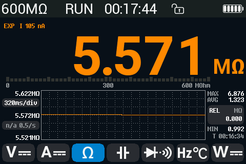

# Experimental 600 MΩ range

Ohm r7 (`OHM600` in [`src/dmm.rs`](../src/dmm.rs)). Manual only: the range
page's **600MΩ experimental** item and SCPI `RESistance:RANGe` above 60 MΩ
select it. The autorange, the AUTO key's short-press range steps, `RES:RANG
MAX` and a restored setting never do. The screen marks it with **EXP**
before the test current. There is no accuracy label.

## Method

The stock 60 MΩ row is a current source with an absolute reference (~20 nA,
*inferred* from the stock Rref constant 63 M and REFO 1.25 V). At 600 MΩ it
would need ~12 V; the source gives 3.2 V at most. The stock 6 MΩ row
(Rref 10 MΩ, ratiometric) cannot take a ratio of 60 between the voltage
across Rx and across Rref either.

r7 is the 6 MΩ row (`CFG_F10_P8CLR[5]`) with three bytes changed:

| byte | value | |
|---|---|---|
| R22 | 0x16 | AD1 200 ms (10 mains periods at 50 Hz) |
| R28 | 0x31 | AD1 reference PB6 − AGND (the MAX6190, absolute) |
| R31 SFUVR | 3 | OP3 on AGNDP9, ≈1.05 V above AGND |

AD1 runs OP1O − PB3 throughout. Two phases switch only R32, OP1's input:

| phase | R32 | OP1+ | AD1 reads |
|---|---|---|---|
| A | 0x3C | PB0 (the jack through 900 k) | Vx, the jack against COM |
| B | 0x39 | FB (OP3's side of Rref) | Vfb |

R = 10 MΩ · gain · Vx / (Vfb − Vx − off − leak · Vx · 10 MΩ), the leak
learned on open leads (below). Both phases go through the same OP1, AD1
input and reference, so the reference's value and OP1's offset cancel. Per
phase `skip` (2) results are dropped after the switch and the median of
`keep` (3) is taken: one reading per ~2 s, final from the first one (`READ?`
waits for it: the deadline is 2.5 s later than other rows'). The display
averages the last 4 readings and starts over on a step above 2 %. OL: no
drop left, or R above 618 MΩ. LIVE?: the jack below COM, or above FB.

Digits: one range over three decades, so the 6000-count format of the
value's decade (5.570 / 55.70 / 557.0 MΩ; a decade change needs 3 % past
6 / 60 MΩ), plus the small extra digit once 4 readings are in and their
mean's spread (sd / √4) is under 0.7 of that digit (off again above 1.3). The bargraph's scale stays
0 … 600 MΩ. Test current: **EXP I 105 nA** on the DMM page, the AGNDP9
short-circuit current through 10 MΩ ([short.csv](data/short.csv),
`AGNDP9,R10M`). The range page hides the 0.90 / 0.28 mA buttons while
600 MΩ is chosen (its source is fixed) and shows "100 nA" there.

## Why AGNDP9

V/Ω open, R10M path, `DBG:SRC` with the jack read through OP1O, current =
(FB − jack) / 10 MΩ ([leak-open-op1o.csv](data/ohm600m-2026-10-28/leak-open-op1o.csv)):

| OP3 tap | FB (V) | jack (V) | current into the jack |
|---|---|---|---|
| AGNDP9 | 1.04746 | 1.04754 | −8 pA (the method's limit, ±10 pA) |
| AGNDP0 | 0.09112 | 0.09617 | −0.50 nA |
| VDS1 | −0.97378 | −0.95787 | −1.59 nA |
| VDS15 | 2.198 | 2.483 | – (OP1O clips at ~2.48 V) |

These `DBG:SRC` points (50 ms conversions, one row write per tap) suggested
a few GΩ from the jack to a node near 1.05 V, and so OP3 at AGNDP9 to keep the
leak small. With VDS15 (2.1 V) the jack sits 1 V away from that node.

Read through PB0 directly (no OP1), the jack reads 0.87 … 1.61 V for sources
from −0.97 to +2.2 V ([leak-open-pb0.csv](data/ohm600m-2026-10-28/leak-open-pb0.csv)):
PB0 itself is loaded when AD1 reads it without OP1.

## The leak on open leads, and its correction

With the r7 row itself (the 0.4.0 build, 200 ms, both phases through OP1),
open jacks give Vfb − Vx = +485 µV (sd 29 µV per pair, 60 s, falling slowly
from ~540 to ~470 µV): 48.5 pA through Rref with the jack at 1.047 V, as if
~21.6 GΩ were across the jacks ([build-0.4.0-open.txt](data/ohm600m-2026-10-28/build-0.4.0-open.txt)).
It is not OP1's offset: on 5.57 MΩ, FB through OP1 and FB on AD1 directly
differ by about 6 µV ([phases-5m57.csv](data/ohm600m-2026-10-28/phases-5m57.csv),
configs B2 and B1). The `DBG:SRC` figure at AGNDP9 (−8 pA) used another row
setup; why the two differ is *unknown*.

Uncorrected, 48.5 pA is 2.8 % of the 1.7 nA test current at 600 MΩ (the
reading low). The firmware learns it: while the drop is below 1.5 mV (an Rx
above ~7 GΩ) with the jack within 10 % of FB, from the second such reading
on, it takes leak = drop / Rref / Vx as a conductance (a mean over ~4) and
subtracts leak · Vx from the current. A drop of zero or below (the jack at
or above FB: a charged capacitor, a source) is never learned, and an Rx above
~7 GΩ counts as open (its conductance joins the leak). That treats the leak as a resistor
across the jacks; whether it is one is *unknown*.

Over 13 min on open leads (b64b287c, [build-b64b287c-open-13min.csv](data/ohm600m-2026-10-28/build-b64b287c-open-13min.csv)):
after the first minute the learned leak stays at 0.0423 … 0.0436 nS (±1.5 %,
Vfb − Vx 444 … 456 µV per minute), every reading OL; at 600 MΩ that is
±0.04 % of the reading. Across the evening it was 0.041 … 0.059 nS
(several power-ups and resistor swaps), so one learned an hour earlier can
be off by up to ~0.5 % at 600 MΩ. At 600 MΩ the jack is at
nearly the open voltage, so the correction holds there whatever the model;
at 5.57 MΩ it is 0.03 %. It lives in RAM: until the leads have been open
once after power-up, 600 MΩ reads up to ~3 % low.

## Device checks (2026-10-28, one unit)

Resistors read by another meter: 0.9925 MΩ and 5.5693 MΩ. Stock rows
([stock-readings.txt](data/ohm600m-2026-10-28/stock-readings.txt)), the
prototype with `DBG:HY:CAP?` on the 6 MΩ row with the r7 bytes and Vfb on
AD1 directly ([cap-blocks.txt](data/ohm600m-2026-10-28/cap-blocks.txt);
5.57 MΩ also with Vfb through OP1, [phases-5m57.csv](data/ohm600m-2026-10-28/phases-5m57.csv)),
and the 0.4.0 build's r7 ([build-0.4.0-5m57.txt](data/ohm600m-2026-10-28/build-0.4.0-5m57.txt),
no leak correction; [build-0.4.0-two.txt](data/ohm600m-2026-10-28/build-0.4.0-two.txt)
and [build-0.4.0-5m57-leak.txt](data/ohm600m-2026-10-28/build-0.4.0-5m57-leak.txt),
leak learned, 0.041 / 0.059 nS; the final build, [build-35a47b9e-final.txt](data/ohm600m-2026-10-28/build-35a47b9e-final.txt):
5.5691 … 5.5694 MΩ on 5.5693 MΩ, no leak learned yet after power-up):

| resistor | stock 6 MΩ | stock 60 MΩ | prototype | 0.4.0, no leak | 0.4.0, leak learned |
|---|---|---|---|---|---|
| 0.9925 MΩ | 0.9938 | – | 0.9945 | – | 0.9921 … 0.9970 (drifting; after the resistor was handled, *inferred*) |
| 5.5693 MΩ | 5.5756 | 5.5721 | 5.5701 | 5.5705 | 5.5705 … 5.5713 (the first two, 5.5638 and 5.5647, settling after the swap) |

*The device's screenshot (MAX 6.876 MΩ: the resistor change).*

Per conversion (200 ms) in the prototype: Vfb sd 1–7 µV, Vx 6–35 µV in most
blocks; a block holding a switch transient 80 … 2700 µV. The first result
after a switch can be off by up to 4 mV (OP1's input stepping from 0.37 V to
1.05 V); later results drift by ~20 µV over 2 s. On 5.57 MΩ the 0.4.0
build's readings have an sd of 0.0002 MΩ.

A current in the A jack (the owner's PSU, ~20 mA, on A / COM, V/Ω open;
[build-b64b287c-a-current.txt](data/ohm600m-2026-10-28/build-b64b287c-a-current.txt),
[build-b64b287c-a-current-ranges.txt](data/ohm600m-2026-10-28/build-b64b287c-a-current-ranges.txt)):
600 MΩ raises LIVE, not A-JACK, as 600 Ω, 60 MΩ and AUTO do on the same
input (the open TODO item on A-jack currents in ohm). The PSU's COM lead
alone already makes the open input read ~30 MΩ: a ground loop through the
PSU (*inferred*), not the A current.

Not checked: any resistor above 5.57 MΩ, the noise and settling at hundreds
of MΩ, the leak over hours (humidity, temperature) and its dependence on
the jack voltage.

## Tuning without a reflash

`DBG:OHM6 gain,off_uV,skip,keep,leak_nS` sets the RAM values (an empty
field keeps its value; a leak value freezes the learning, a negative one
restarts it); `DBG:OHM6?` answers `gain,off_uV,skip,keep,leak_nS,Vx,Vfb`
(V, the last phase medians). Defaults 1, 0, 2, 3, 0 (the leak until learned).
With the display smoothing on (Settings), its mean stacks on the range's own
4-reading mean: at High (16 readings) a step takes ~40 s to settle.

## Emulator

[`emu/hy3131/ohm600mtest.py`](../../emu/hy3131/ohm600mtest.py): the range
rules (explicit, MAX, by value, AUTO, the AUTO key). The HY3131 model reads
the ohm rows ratiometrically only (no absolute AD1 reference, SOP1P masked),
so the r7 value is not modelled.
